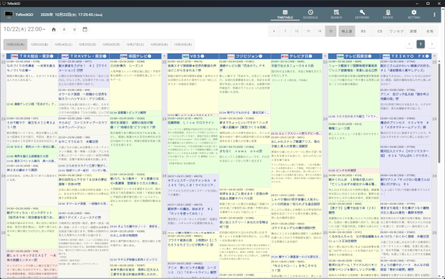
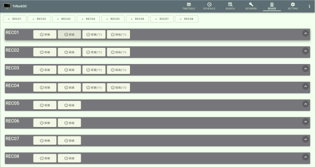
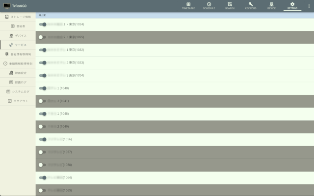
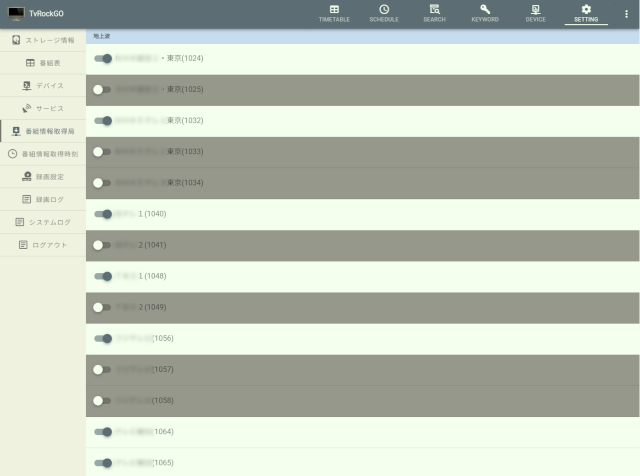
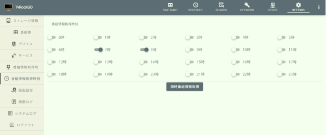
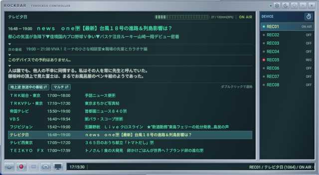
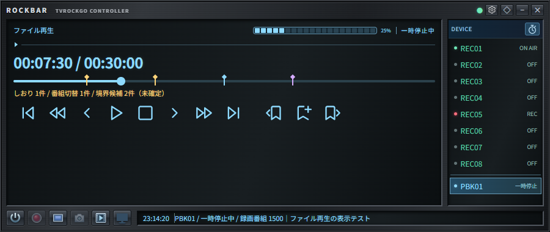

# TvRockGO

TvRockGOはテレビ番組の視聴・録画アプリを制御するサーバーとブラウザで使用するWebアプリです。番組表の閲覧、録画予約、キーワード予約、番組・字幕検索、デバイスの起動・終了を行えます。  
サーバーはGo製でCGOを使用しません(Pure Go)。現在の配布版と録画・視聴環境の対象はWindowsです。Linux/macOS向けのビルドとサービス配置の手順も用意していますが対応はしていません。  
旧TvRockと同じ１実行ファイルで動作し、視聴に特化した付属アプリケーションとしてRockbarを用意しています。

## 目次

- [主な機能](#主な機能)
- [動作環境と必要なもの](#動作環境と必要なもの)
- [導入手順](#導入手順)
- [設定ファイル](#設定ファイル)
- [起動方法とトレイ操作](#起動方法とトレイ操作)
- [局情報と番組情報の取得](#局情報と番組情報の取得)
- [Rockbar](#rockbar)
- [終了方法](#終了方法)
- [更新とバックアップ](#更新とバックアップ)
- [旧TvRockの番組データの取り込み](#旧tvrockの番組データの取り込み)
- [困ったとき](#困ったとき)
- [関連ドキュメント](#関連ドキュメント)
- [ライセンス](#ライセンス)

## 主な機能

| 機能 | 内容 |
| --- | --- |
| 番組表 | 地上波・BS・CS・ワンセグの番組情報と番組詳細を確認します。 |
| 録画・視聴予約 | 番組表や検索結果から予約し、録画・視聴アプリの起動と終了を制御します。 |
| キーワード予約 | 条件に一致する番組を検索し、自動で録画予約します。 |
| 番組・字幕検索 | 蓄積した番組情報や、保存した字幕を検索します。 |
| デバイス操作 | ブラウザから視聴・録画の開始と終了、選局、状態確認を行います。 |
| 番組情報・局ロゴの受信 | 対応アプリから番組情報と局ロゴを受信します。番組情報の定期取得も設定できます。 |
| Rockbar | 現在の番組や次の番組の確認、選局、リモート視聴、ファイル再生の視聴デバイスを操作します。Windows版とブラウザ版があります。 |
| リモート視聴 | Windows版Rockbarと視聴アプリを使い、LAN内の別PCで視聴します。１台のPCで録画・視聴を操作している状況と同じ様にサーバーとクライアントに別けて操作ができるようになります。 |
| ファイル再生 | Rockbarの再生デバイスボタンを押し、再生デバイスを起動します。この再生デバイスから録画したファイルを再生します。 |
| 電源管理 | スリープタイマーや予約前の復帰を設定します。利用環境での動作確認が必要です。 |

## 動作環境と必要なもの

配布ビルドはWindows x64向けです。使用するチューナー・BonDriverと、録画・視聴アプリが動作するPCを用意してください。

| 必要なもの | 説明 |
| --- | --- |
| チューナーとBonDriver | 使用するアプリでチャンネルスキャンを済ませてください。TVTestの場合は使用するドライバに対応した`.ch2`ファイルを確認します。 リモート視聴にはBonDriver_SRTを使用します|
| TvRockGO専用の`TvRockDTV.dll` | 旧TvRock付属のDLLとは互換ではありません。録画・視聴アプリのビット数に合わせてx86またはx64版を使用してください。 |
| 対応した録画・視聴アプリ | TVTestには専用DLLに対応した`TvRockOnTVTest.tvtp`が必要です。TSTask／RecTestは専用の`TvRock.cpp`パッチを適用したソースからビルドする必要があります。 パッチは`TvRockOnTVTest`のリポジトリに公開しています。|
| Webブラウザ | Webアプリから番組表や録画予約を操作します。 |
| 録画保存先 | 十分な空き容量と実行ユーザーの書き込み権限が必要です。 |

このリポジトリには、専用DLL・TVTestプラグイン・TSTask／RecTest用パッチのソースや配布物は含まれていません。別途用意してください。配布版を使用するPCにGoやNode.jsをインストールする必要はありません。

### 関連リポジトリ

本体と専用コンポーネントの参照先です。導入時には各リポジトリの状況、配布物、対応バージョンを確認してください。  
各実行バイナリは各**Releases**の**Latest**からダウンロードできます。

| プロジェクト | 用途 |
| --- | --- |
| tvrockgo | サーバー・Webアプリ・Rockbar：[tvrock-master/tvrockgo](https://github.com/tvrock-master/tvrockgo) |
| tvrockdtv | TvRockGO専用`TvRockDTV.dll`：[tvrock-master/tvrockdtv](https://github.com/tvrock-master/tvrockdtv) |
| tvrockontvtest | TvRockDTVと接続するTVTest用プラグイン：[tvrock-master/tvrockontvtest](https://github.com/tvrock-master/tvrockontvtest) |
| bondriver_srt | SRTプロトコル・ストリーム受信用BonDriver：[tvrock-master/bondriver_srt](https://github.com/tvrock-master/bondriver_srt) |

## 導入手順

1. 配布ZIPを展開し、`tvrockgo.exe`と同じフォルダに`conf`、`static`、`template`があることを確認します。実行ファイルだけを移動しないでください。

   同じフォルダの`TvRockGO-Manual.pdf`で、導入手順と各機能のガイドをオフラインで読めます。

2. `data`と`log`フォルダを用意し、展開先と録画保存先に書き込めることを確認します。配布ZIPには空のフォルダを含みます。
3. リポジトリからダウンロードした`TvRockDTV.dll`と`BonDriver_SRT.dll`を`TVTest.exe`と同じフォルダへ入れ、`TvRockOnTVTest.tvtp`を`TVTest`の**Pluginsフォルダ**へ入れます。`TvRockGO`へ対応した`TSTask.exe(RecTest.exe)`と同じフォルダにも`TvRockDTV.dll`を入れて下さい。  
リポジトリは[関連リポジトリ](#関連リポジトリ)を参照してください
4. [設定ガイド](docs/configuration.md)を参考に、初回起動前に`conf/tvrock.org.yml`を編集します。録画・視聴アプリのパス、BonDriver、デバイス数、録画保存先、ログインアカウントを自分の環境に合わせて設定してください。
5. `tvrockgo.exe`を起動します。Windowsではトレイに常駐します。
6. 初期設定の`host: "localhost:80"`なら、ブラウザで[http://localhost](http://localhost)を開き、設定したアカウントでログインします。
7. [局情報と番組情報の取得](#局情報と番組情報の取得)を行い、短い録画予約で動作と保存先を確認します。

## 設定ファイル

初回起動前は`conf/tvrock.org.yml`を編集します。運用設定`conf/tvrock.yml`が存在しない場合だけ、ひな形を読み込んで生成します。以後は運用設定を使い、ひな形は読み込みません。ひな形は設定を再生成するときに必要です。

- 録画・視聴アプリのパス、BonDriver、デバイスID、録画保存先を設定します。
- 使用するデバイスに合わせ、録画予約と番組情報取得の優先順位を設定します。
- ログイン用のアカウントとパスワードを変更します。

初回起動後に設定ファイルを手動で変更する場合はサーバーを終了してから`conf/tvrock.yml`を編集し、再起動してください。Web画面から変更できる項目は画面上で設定できます。  
初回起動で`conf/tvrock.org.yml`の設定が失敗した場合は一旦TvRockGOを終了し、`conf/tvrock.yml`を削除して`conf/tvrock.org.yml`を編集。TvRockGOを起動させ`conf/tvrock.yml`を再生成してください。

具体的なYAML例、補助デバイス、LAN接続、認証、電源管理は[設定ガイド](docs/configuration.md)を参照してください。

## 起動方法とトレイ操作

Windowsでは`tvrockgo.exe`を起動するとトレイに常駐します。右クリックのメニューから番組表・Rockbarを開き、サーバーを終了できます。通知領域にアイコンが見当たらない場合は隠れたアイコンの一覧も確認してください。

Windowsの自動起動にはユーザーのスタートアップへショートカットを登録してください。ログオフ後の録画継続には対応しません。

起動例、保存先の構成、Linux/macOSのサービス配置は[起動方式とサービス配置](docs/startup.md)を参照してください。

## 局情報と番組情報の取得

### 1. 局情報を取得する

[設定ガイド](docs/configuration.md#電源管理任意)で設定が終わり、`tvrockgo.exe`を起動させると、初回起動時は局情報と番組情報がありません。  
DEVICEタブで地上波・BS/CSのデバイスをそれぞれ「録画」または「視聴」ボタンからデバイスを起動します。  
デバイスから局情報が届いたことを確認して（SETTING → サービス）一旦デバイスを終了(ボタン)してください。ひな形の構成では`REC01(地上波)`と`REC05(BS/CS)`が例になります。

### 2. 使用するサービスを選ぶ

SETTING →「サービス」に取得した局が表示されます。使用しないサービスは左端のスイッチをOFFにします。

サブチャンネルはなるべく有効にしておいて下さい。地上波・BSの番組表では通常は表示されません。地上波・BSのボタンが選択されている時にもう一度ボタンを押すと`マルチ`表示になり、サブチャンネル付きの番組表になります。

### 3. 番組情報を取得するサービスを選ぶ

SETTING →「番組情報取得局」で取得対象を選択します。地上波は取得したい局を指定します。BS/CSは複数局分の情報をまとめて取得できる場合がありますが、取得結果を確認し不足する局があれば対象を追加してください。BS/CSはそれぞれ主要な2局程を選択していれば全て取得できます。

### 4. 番組情報を取得する

SETTING →「番組情報取得時刻」で「即時番組情報取得」を押します。取得スケジュールが開始され番組表へ反映されます。定期取得に使用する時刻もこの画面で設定してください。

放送してない時間帯や受信状態が不安定な場合は番組情報が取得できないので注意して下さい。
規定時間内に選局を確認できない局や番組情報数が0件のままの局は局名と理由を警告ログに記録して次へ進みます。0件の場合は放送休止や受信状態を確認してください。取得予約の終了時刻に達して残った局は未処理局数としてログに記録します。

### 5. 番組表・検索・キーワード検索予約で録画番組を予約

デバイスの準備と番組情報が揃えば予約が可能です。

番組表・録画予約の使用法については[Webアプリ・番組表の使い方](docs/tvguide.md)を参照して下さい。

## Rockbar

Rockbarは視聴を手軽に扱うためのアプリです。TvRockGOのデバイス操作や番組情報の確認、リモート視聴、録画ファイルの再生に使うコントローラーになります。TimeKeeperもRockbarに収めています。  
Webの番組表とは異なり、インストーラーからインストールされたWindowsのアプリになりますが、Webからも使用できます。

- Windows版：配布物の`rockbar/Rockbar-Setup-<バージョン>-x64.exe`を実行し、インストール後にスタートメニューから起動します。歯車ボタンからサーバーURLを設定し、ログインします。
- ブラウザ版：[http://localhost/static/rockbar/](http://localhost/static/rockbar/)を開きます。別PCや別ポートの場合は接続先を置き換えてください。

再生デバイス  

Rockbarの仕様法については[Rockbarの使い方](docs/rockbar.md)を参照して下さい。

## 終了方法

Windowsの通常起動はトレイの「終了」を選択し、「TvRockGOを終了しますか？」の確認で「はい」を選択します。「いいえ」を選ぶと起動を継続します。`--console`で起動した場合はCtrl+Cを1回押します。Linux/macOSではサービス管理ツールから停止します。いずれも定期処理・検索・通信・録画タスクの終了を待ち、検索インデックスとDBを閉じてから終了します。終了時は実行中のカスタムコマンドも中断します。

処理中のDB更新や検索インデックスの書き込みによって、終了まで少し時間がかかる場合があります。ログに終了処理の段階を表示します。通常は終了完了まで待ってください。残った`*.db-wal`・`*.db-shm`を手動で削除しないでください。

## 更新とバックアップ

サーバーを終了してから、`conf/tvrock.yml`、`data/`、必要なログ、`static/cdt/`の局ロゴ、録画ファイルをバックアップしてください。保存先を変更している場合は、その実際のパスが対象です。稼働中のSQLiteファイルのコピーは避けてください。

更新時は、設定とDBを保持し、実行ファイル・Webアプリ・テンプレートを新しい配布物へ置き換えます。`conf/tvrock.org.yml`の追加項目も確認してください。新しいひな形で運用中の`conf/tvrock.yml`を上書きしないでください。`static`を置き換える場合は、バックアップした局ロゴを戻します。

## 旧TvRockの番組データの取り込み

旧TvRockで「番組データをテキストで保存する」を有効にしていた場合、過去の番組情報をTvRockGOのデータベースへ取り込めます。対象フォルダには`dtv.ini`と`timemachine`フォルダが必要です。

詳細は[過去番組を検索する・旧TvRockのデータを移行する](docs/tvguide.md#過去番組を検索する・旧TvRockのデータを移行する)を参照してください。

## 困ったとき

| 症状 | 確認すること |
| --- | --- |
| 起動できない | 実行ファイルの配置先または`--data-dir`で指定した場所の`conf/tvrock.yml`、YAMLの字下げ、書き込み権限、`log/`のエラーを確認します。運用設定がない場合は`conf/tvrock.org.yml`も必要です。Windowsではエラーダイアログや`--console`起動も確認します。 |
| トレイからスリープタイマーを操作できない | `powermanagersetting.powermanager: true`で起動しているか確認します。手動で設定ファイルを編集する場合は先にサーバーを終了してください。 |
| Web画面が開かない | サーバーが起動しているか、ポートが競合していないか、`static/index.html`と`template/`があるかを確認します。LAN接続では待ち受けアドレスとファイアウォールも確認します。 |
| ログインできない | `useraccount`と接続先URL、Cookieのドメイン、HTTP/HTTPSと`sessionsecure`の設定を確認します。 |
| デバイスが起動しない／局が表示されない | アプリのパス、BonDriver、`/DID`、専用DLL・対応プラグインとそのビット数、チャンネルスキャンを確認します。 |
| 番組表が空 | 局情報を取得し、サービスと番組情報取得局を有効にして、即時取得を実行します。 |
| 録画できない | 保存先の存在・権限・空き容量、デバイス優先順位、予約の重複を確認します。 |

## 関連ドキュメント

| 文書 | 内容 |
| --- | --- |
| [Webアプリ・番組表の使い方](docs/tvguide.md) | 画像付きの番組検索・予約・字幕履歴・過去番組・表示設定のマニュアル |
| [Rockbarの使い方](docs/rockbar.md) | 画像付きのデバイス操作・ライブ録画・リモート視聴・ファイル再生・TimeKeeperのマニュアル |
| [設定ガイド](docs/configuration.md) | デバイス、優先順位、補助デバイス、LAN接続・認証、電源管理の設定例 |
| [カスタムコマンド](docs/custom-commands.md) | 実行タイプ、JSONによる番組情報の受け渡し、バッチ・PowerShellの例と移行手順 |
| [起動方式とサービス配置](docs/startup.md) | 起動オプション、トレイ操作、Linux/macOSのサービス配置 |
| [Rockbarの操作と開発](rockbar/README.md) | Windows版・ブラウザ版の操作、設定、ビルド |
| [リモート視聴](docs/remote-viewing.md) | LAN内の別PCでの視聴、送信内容、視聴予約 |
| [TSファイル再生](docs/playback.md) | Rockbarの再生操作、録画ログからの再生 |
| [開発ガイド](AGENTS.md) | ソース構成、開発環境、ビルド、テスト |
| [リリース手順](docs/releases.md) | タグ、バージョン指定、CI、配布ZIP |

## ライセンス

本プロジェクトのライセンスは[MIT License](LICENSE)です。依存ライブラリ、録画・視聴アプリ、DLL・プラグインは、それぞれのライセンスと配布条件に従ってください。

Go実行時依存、Webアプリ、Rockbar、フォント・アイコン等の表記・ライセンス本文は[サードパーティーライセンス](THIRD_PARTY_LICENSES.md)に収録しています。ログイン画面の「License」でも同じ内容を確認できます。Electronの内包部品の全文は、配布物の`licenses/electron/LICENSES.chromium.html`、Windows版Rockbar単体ではインストール先の`LICENSES.chromium.html`にまとめています。
