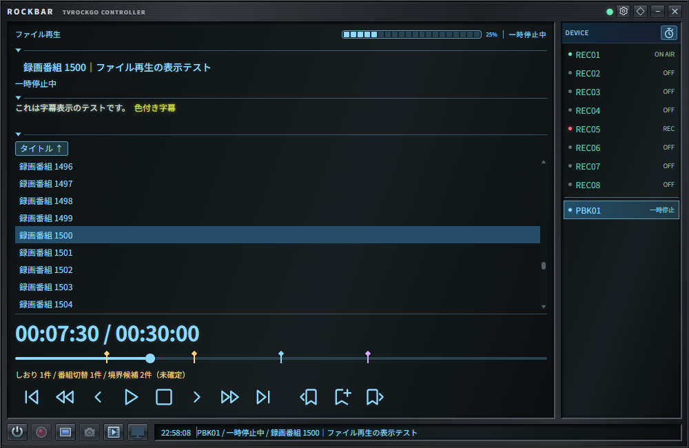

# TSファイル再生（Playback）



キャプチャ右横の再生デバイスボタン、録画ログの再生ボタンから、TvRockGOのPCにある録画済みTSを接続中のElectron版Rockbarで再生できます。実行中サーバー・DLL・プラグインへの自動配置は行いません。

## 準備

- Playback対応のTvRockGO、Rockbar、TvRockDTV、TvRockOnTVTestを使用してください。BonDriver_SRTは既存の受信機能と、接続開始時のバッファー消去を使用します。
- 各Rockbarの「リモート視聴設定」でPBK01～PBK08の視聴アプリを設定します。配信方式はSRT、起動オプションは通常の視聴と同様に`/d BonDriver_SRT.dll /nd`などを指定します。
- ポート・基準ポート・遅延・パスフレーズをBonDriver_SRT.iniと合わせてください。同じPCで同時に使う通常視聴・Playbackのポートは重複させないでください。LAN接続時はBonDriver_SRTのListenAddressとファイアウォールも設定します。
- 録画ログの`filename`をTvRockGOのプロセスから読み取れる必要があります。188バイト形式の録画済みTSと、TvRockGOが録画中として管理している追記中のTSを対象とします。

## 操作

キャプチャボタンの右にある再生デバイス追加ボタンを押すと、空きPBKを追加・選択し、TVTestを起動して受信待受状態にします。Rockbarのデバイス一覧では、待受中を含め使用中のPBKだけを表示します。停止・ファイル終端ではPBKとTVTestを維持し、受信待受状態へ戻ります。電源ボタンでTVTestを終了し、PBKを一覧から削除します。接続先変更・Rockbar切断でも終了します。

appの「録画ログ」で再生ボタンを押すと、開始時点で接続しているElectron版Rockbarそれぞれに空いているPBKを割り当て、再生を要求します。追加されたPBKは自動選択されます。各Rockbarの操作はそのRockbarの再生だけに適用します。ブラウザ版は視聴アプリを起動できません。視聴設定の不足や起動失敗はRockbarに表示されます。後から接続したRockbarは自動参加しません。

現在の番組欄には録画タイトル、字幕欄には各視聴アプリが解析した字幕を表示します。「次の番組」「次の予約」は非表示です。未使用PBKの設定は、デバイス一覧ではなく視聴アプリ設定画面から行えます。

Playback選択時は画面の表示色が水色になります。デバイス一覧は通常デバイスを緑、PBKを水色で表示し、両グループの間に仕切り線を入れます。字幕の下には折り畳めるファイル表示エリアを置き、その下を再生操作パネルとしています。

ファイル一覧は1つの並べ替えボタンを押すたびに、日付の新しい順・古い順、タイトルの昇順・降順へ切り替わります。クリックで選択し、ホバーで録画情報とパスを確認できます。ダブルクリックまたはEnterで、選択中のPBKだけで再生します。待受中のPlayボタンでも選択ファイルを再生できます。完了済みと録画中の録画を表示し、未開始予約は除外します。録画中には印を付け、録画中のファイルも追いかけ再生できます。

認証付き`GET /playback/recordings`は、現在のDBにある該当`RecordingSchedule`の配列を返します。過去DBは取得対象外です。各要素には保存先を識別する`slot`と録画中を示す`recording`を追加します。視聴予約とファイル名がない項目は除外します。ファイル選択の要求には録画IDと`slot`の両方を使用します。

左上の「ファイル再生」を押すと、現在再生中のファイル（解析・準備中、一時停止中も含む）を選択し、その行へスムーズにスクロールします。再生中のファイルがなければ選択中の行へ移動し、再生も選択もなければ何もしません。再生デバイスへ切り替えた時は選択中のファイルへスクロールします。

再生ファイル一覧は通常の選局欄と同じ枠なしのスクロールリストとし、選択行は背景色で示します。TimeKeeperでは再生デバイスを一覧・台数集計から除外し、通常表示へ戻ると使用中の再生デバイスを再表示します。TimeKeeperへの切替では再生を停止しません。

`recording_ts_analysis`の`resume_position_ms`に視聴位置を10秒ごと・停止時に保存し、次の再生はその位置に対応するPCR索引から開始します。末尾到達・最後までの再生では0へ戻します。保存位置はRecordingScheduleごとに共通で、複数のRockbarで同時に視聴する場合は最後に保存した位置を使います。`playback_updated_at`は保存日時のUNIXミリ秒です。解析のやり直しでは同じファイルの位置を保持し、アーカイブにも引き継ぎます。

再生要求時にファイルが存在しなければ`file_deleted=1`を保存し、次回以降のファイル一覧から除外します。ファイルを開く権限の不足・その他のエラーでは削除扱いにしません。フラグを立てた時は既存のScheduleUpdate通知で一覧を更新します。ファイルそのものや録画ログは削除しません。録画ログから改めて再生し、通常ファイルとして開けた場合はフラグを解除します。

操作パネルは同梱のLucide線画アイコン（28px）を使用します。時間表示は30px、ボタンの操作範囲は幅45px・高さ38pxで、枠線を省いています。左から先頭、30秒戻る、15秒戻る、一時停止／再生、停止、15秒進む、30秒進む、末尾の順です。一時停止中は中央がPlayに切り替わり、Stopも引き続き表示します。Stopはファイル再生を停止して受信待受状態へ戻します。狭いウィンドウでは操作列を横スクロールできます。アイコンの外部取得は不要です。時間表示とボタンの間に、水色の細いバーと丸いつまみの再生位置スライダーを表示します。ドラッグ中は移動先の時間を表示し、離した時にシークします。移動中はサーバーからの位置情報でつまみを上書きしません。

再生時間と上部プログレスバーは、受信した再生位置を基準に内部の単調時計で進め、新しい位置情報が届いた時に補正します。一時停止・準備中・切断中は進めません。

黒画面待受に対応したTvRockDTV・TvRockOnTVTestでは、停止・ファイル終端時にTVTestのプレビューを無効化し、TVTestを起動したまま映像のない待受へ戻します。次の再生開始時は、この処理で無効化したプレビューを有効に戻します。一時停止では最後の映像を保持します。対応は既存のTVTest APIを使うため、新しいグラフ制御SDKへの対応とは独立しています。受信側が`controlVersion:3`と`idleSupported:true`を報告した場合だけ`idle`を送信し、旧DLL・旧プラグインや制御失敗時は従来のリセットへ戻します。古い構成では黒画面への切替は保証しません。

録画一覧は初回表示・再接続後と、WebSocketのScheduleUpdate（`usc:`）通知を受けた時に取得します。通常デバイスを表示している間の通知は保留し、Playback表示へ戻った時に取得します。定期ポーリングは行いません。取得中に通知が来た場合は、取得完了後に再取得して更新を取りこぼさないようにします。内容が同じならリストのDOMを変更せず、選択だけの変更では選択表示だけを更新します。時計や再生位置の更新で全件を作り直しません。字幕本文は通常デバイスと同じ放送字幕の色を使用し、タイトルの文字サイズも通常表示に合わせます。

最下部のステータスバーは通常、選択したデバイスの情報を表示します。再生要求の受信や準備・接続などの通知がある時は、そのメッセージだけを10秒間表示し、その後に通常表示へ戻ります。エラー時も理由のメッセージだけを表示し、通常のデバイス情報と連結しません。同じ通知が繰り返し届いても表示時間を延長し続けません。PBKを選択していない場合やタイムキーパーモードでも確認できます。「再生中」はSRT接続が成立した状態で、TVTestの実映像を確認した通知ではありません。

ステータスバーはホバーでは停止しません。クリックすると文字の先頭を時計の隣へ戻して停止し、もう一度クリックするとその位置からスクロールを再開します。停止中に通知が更新されても先頭位置を保ちます。フォーカスしてEnter／Spaceでも切り替えられます。

## 実装と範囲

### 録画後のTS解析

appの「設定 → 録画設定」に「録画後にTS解析処理を行う」を追加しています。設定キーは`recordersetting.analyzetsafterrecording`で、既定値は`false`です。ONの場合、録画タスク終了後に解析を登録し、サーバー上のファイルの書き込みが落ち着いてから1件ずつ解析します。録画中のファイルは解析しません。キューはDBに保存し、解析中にサーバーを終了した場合は次回起動時に再処理します。解析中は自動スリープを抑止します。既存の録画ログを設定ONだけで一括解析する処理は行いません。

新規テーブル`recording_ts_analysis`の主キー`schedule_id`は`RecordingSchedule.ID`と対応します。録画ログのアーカイブ時に解析結果も移し、録画ログを削除した場合は解析結果も削除します。録画ファイル自体は読み取り専用です。

`archiver.go`の録画ログ移動と同じ`endtime < Now() - CurrentProgramThreshold`に該当するスケジュールIDについて、解析結果・視聴位置・ファイル削除フラグ・手動しおり・番組切替情報の全カラムをアーカイブ用DBへコピーします。完了フラグや解析状態による追加の絞り込みは行いません。コピー後は移動元の解析行とスケジュールを同じトランザクションで削除し、削除トリガーの有無に依存しない構成です。コピー・削除の失敗時は未確定のトランザクションをロールバックして移動元を残します。アーカイブ側を先にコミットするため、移動元のコミットに失敗した場合は両DBにデータが残りますが、同じIDで再試行できます。

保存する項目は次のとおりです。

- ファイルパス、サイズ、更新日時、先頭・末尾各64KiBのSHA-256照合情報、サービスID、解析バージョン。
- 処理状態（queued／running／ready／error）、登録・開始・完了日時、所要時間、失敗理由。
- PCRに基づく総再生時間、PCR／PMT PID、ストリームのPID・種類、シーク用の時刻とバイト位置の索引。
- パケット数、TEI・スクランブルパケット数、連続カウンター異常数、PCRの大きな不連続数、TS全体の平均ビットレート。
- CM関連の信号の検出状態と境界候補。候補は時刻・TS位置・信号種別・イベントID・根拠を保存します。

ONで有効な保存結果があれば、再生時にはファイル照合と索引読み込みだけを行います。ファイル変更、解析バージョン不一致、不正な保存索引、未解析の場合は再解析します。OFFの場合は保存済み索引があっても再生時にファイル全体を解析し、その結果をDBへ保存します。解析結果のDB保存に失敗しても、ファイル解析自体が成功していれば再生を継続します。

### TS情報だけによるCM境界候補

映像・音声のデコードや外部ツールは使用しません。選択サービスのPMTにSCTE-35（stream_type 0x86）があり、CRCが正常な`splice_insert`のprogram spliceとPTS指定がある場合に、挿入開始／終了信号を境界候補として保存します。繰り返し信号は重複排除します。暗号化・取り消し・component splice・immediate splice・未対応のコマンドは候補にしません。

挿入信号はCMそのものを保証しないため、`confirmedCM`は`false`です。信号がない録画では`cm_status=not-signaled`、対応する境界を得られなかった場合は`no-supported-splice-boundary`、候補がある場合は`splice-candidates`を保存します。PCR不連続、パケットエラー、一定の秒数間隔だけからCMを捏造する判定は行いません。CM信号のない一般的な録画について、この方式でCM位置を確定することはできません。

解析結果は再生デバイスの状態通知の`cmStatus`・`cmBoundaries`でRockbarへ送ります。シークバーに黄色い境界マーカーを表示し、ホバーで開始／終了候補と時刻を確認できます。マーカーをクリックするとその位置へ移動します。候補件数には「未確定」と表示し、候補がない場合も対応信号の有無を表示します。古いサーバーから情報が来ない場合は「情報なし」と表示します。

通常の再生ボタン群の右に18pxの余白を置き、Lucideのしおりと左右矢印を組み合わせた「前のCM境界候補へ」「次のCM境界候補へ」ボタンを並べます。再生中・一時停止中に操作でき、該当する前後の候補がない時は無効です。自動CMスキップではなく、開始・終了の両候補を順に移動します。移動には既存の秒単位・PCR索引によるシークを使い、フレーム単位の正確なCM先頭ではありません。秒単位の丸めと索引の誤差で同じ候補へ戻り続けないよう、現在位置の前後1.5秒は現在の境界として扱います。停止・次ファイルの解析開始時に以前の候補を消し、定期HTTP取得は追加しません。

左右のしおりボタンの間に「現在の位置にしおりを追加」（しおり＋）を置きます。再生中・一時停止中の表示位置を手動しおりとして登録し、シーク操作の結果を待つ間は追加を無効にします。水色の手動しおりと黄色の自動CM境界候補を同じシークバーへ表示し、左右のボタンでは両方を時刻順に移動します。手動しおりの右クリックメニューから「このしおりを削除」、またはフォーカスした手動しおりでDeleteキーを押すと削除できます。自動候補にはこの削除操作を表示しません。

手動しおりは`recording_ts_analysis.manual_bookmarks_json`へ録画IDごとに保存し、再生状態の`manualBookmarks`で配信します。停止・再起動・TS再解析後も保持し、アーカイブにも引き継ぎます。追加・削除は操作要求時に即保存し、同じ録画を視聴中の他のRockbarにも反映します。1秒以内の近い位置への重複登録は抑止します。自動検出結果の`cm_candidates_json`は変更しません。カラムはCREATE定義に追加するだけで、既存DBのマイグレーションは行いません。

### SID別のPID送出によるCM境界候補

録画済みTSでは、運用設定の`tscmboundaryrules`に定義したSIDに一致する場合、指定PIDのパケット送出も監視します。通常のサービスID（下位16bit）で指定でき、録画ログに含まれる上位16bitの放送種別を除いて照合します。放送種別を限定する場合はTvRockGOの上位ビット込みのSIDも指定でき、その完全一致を優先します。例えば`sid: 1040`は地上波の録画ログのSIDが66576（65536＋1040）でも適用されます。公開用ひな形`conf/tvrock.org.yml`の初期値は次のとおりです。

| SID | PID | CM終了位置の補正 |
| --- | --- | --- |
| 1040 | 0x051f | 最後の対象PIDパケット |
| 1056 | 0x081a | 最後の対象PIDパケット |
| 1064 | 0x1005 | 最後の対象PIDパケットから3個前 |
| 23608 | 0x075e | 最後の対象PIDパケットから8個前 |

最初の対象PIDパケットから`startforwardpackets`個後をCM開始候補とし、対象PIDが`nopacketseconds`秒間（ひな形は5秒）届かなければ停止と判定します。開始補正は省略時0で、0なら最初のパケット、3なら4番目の対象PIDパケットです。終了候補は最後の対象PIDパケットから`endbackpackets`個前を使います。開始は後ろへ、終了は前へずらす個数を、それぞれ0以上で指定します。秒数は解析にかかる実時間ではなく、選択サービスのPCRから求めた経過時間です。開始・終了候補には補正先の対象PIDパケット位置とそのPCR経過時刻を使います。別PIDのパケットは個数に含めず、TEI付きパケットと最初のPCRより前のパケットは監視対象から除きます。

設定秒数未満の空白では区間を分けません。停止後に再開すると、開始補正の個数を最初から数え直します。開始補正先のパケットに到達する前に停止または録画末尾となった場合は、その区間の開始候補を付けません。終了補正に必要な個数が足りない区間や、録画末尾までに設定秒数の空白を確認できない区間には終了候補を付けません。その場合も既に検出した開始候補の境界マーカーは保持します。PCRの不連続だけでは停止を判定しません。

設定例（開始を最初の対象PIDパケットから3個後、終了を最後から10個前にする）：

```yaml
tscmboundaryrules:
  - sid: 23608
    pid: 0x075e
    nopacketseconds: 5
    startforwardpackets: 3
    endbackpackets: 10
```

`sid`は1～4294967295、`pid`は1～8190、`nopacketseconds`は1～86400、`startforwardpackets`と`endbackpackets`は0～65535です。`startforwardpackets`は省略でき、既存設定では従来どおり開始補正0になります。公開用ひな形も3局すべて開始補正0です。PIDは16進数でも10進数でも指定でき、設定の保存後は10進数表記になる場合があります。同じSIDの複数定義と範囲外の値は設定読み込み時のエラーになります。`tscmboundaryrules: []`または項目自体が未指定なら、このPID判定を無効にします。文字列による判定は行いません。

設定は起動時に読み込み、変更の反映にはサーバーの再起動が必要です。既存の運用設定`conf/tvrock.yml`へひな形の追記を自動反映する処理はありません。既存環境ではサーバーを停止し、必要な行を運用設定へ追加してください。局別ルールは解析開始時の値を使い、再起動後にPID・停止秒数・開始補正・終了補正の変更や行の追加・削除を検出すると、その局の録画は次の解析・再生時に再解析します。既存の`version`列にルールの識別情報も保存し、他の局のルール変更や行の並べ替えだけではキャッシュを無効にしません。起動時に全録画を一括再解析するものではありません。

候補の根拠は `service-pid-activity`、種別は既存表示と共通の `splice-out`（開始）／`splice-in`（終了）として保存します。局固有の推定なので `confirmedCM=false` とし、候補があれば既存互換の `cm_status=splice-candidates` を使います。Rockbarの境界マーカーと前後移動で利用でき、追いかけ再生は従来どおり解析対象外です。解析バージョンを更新しているため、古い保存結果は次の解析時に再作成します。

### EIT p/fの現在番組切替

選択サービス・PATのTSIDに一致する実ストリームのEIT p/f（table_id 0x4e、current_next=1、section_number=0）から、現在番組のevent_idの切替を自動しおりとして検出します。最初の現在番組は比較基準とし、次番組（section 1）、他サービス・他TS・他ストリームの情報、同一番組の更新、CRC不正や不完全なセクションではしおりを追加しません。以前受信した番組セクションの再送も重複排除します。EIT PID 0x12・0x27に対応し、0x12を優先してソースの混在による誤検出を避けます。

切替セクションを受信し終えた時点のPCR経過時間・TS位置と、切替前後の番組IDを`program_boundaries_json`へ保存し、再生状態の`programBoundaries`で送ります。Rockbarでは紫色のマーカーとして表示し、ホバーで番組IDを確認できます。手動・CM候補と同じ左右のしおりボタンで移動しますが、CMとは分類しません。番組名のARIB文字列は今回デコードしません。情報の送出タイミングに依存するため、実際の映像切替フレームと一致する保証はありません。

### 配信

- `playbackdevices`は通常の`devices`と同じ設定構造を使用する独立テーブルです。省略時はPBK01～PBK08を使用します。予約、チューナー選択、EPG取得へは登録しません。Rockbar側の実行ファイル・オプションを使用し、サーバーのパスをクライアントで実行しません。
- `go-astits`でPAT/PMTから対象サービスのPCR PIDを取得し、元TSのPCRとファイル位置の索引を作ります。`datarhei/gosrt`で受信先ごとにSRT送信します。TSの編集・再多重化・トランスコードは行いません。開始前の索引作成時間はファイルサイズとディスク速度に依存します。
- PCR PIDの取得時はPATと対象サービスのPMTだけを解析します。番組情報（EIT）などの解析エラーで再生開始が止まらない構成です。PATがない場合、録画ログのSIDがPATにない場合、対象PMTがない場合は区別して通知します。配信するTSパケットはこれらの情報も含めて元のまま保持します。
- スキップは目標位置付近のPATから再開します。キーフレームに対するフレーム単位の正確なシークではありません。受信バッファーとデコーダーのため、指定秒数との誤差や映像が復帰するまでの待ち時間があります。
- 対応するTvRockOnTVTestでは、TVTestのグラフ初期化イベントから`IMediaControl`を取得し、映像・音声の一時停止／再開を直接制御します。SDKは更新していますが、基本APIと従来の構造体レイアウトは0.0.10のまま維持し、追加イベントへの対応は実行時に問い合わせます。TVTest本体やBonDriver_SRTの更新は前提にしません。
- 新プラグインはオプションの`TvRockDTVPlaybackCapabilities`関数で対応可否と準備状態を登録します。旧プラグインへ未知の問い合わせを送ることはありません。TvRockDTVの`RCV:`に`controlVersion:2`・`graphPauseSupported`・`graphPauseReady`がそろい、受信接続が稼働中の場合だけ、TvRockGOは`pause-direct`を選択します。新方式ではSRT接続と未送信キューを維持し、TVTestの停止確認後も送出を止めます。
- 参加受信側すべてが新方式で一時停止済みの場合、`resume-direct`で再開確認後にキューを解放します。ファイル位置の巻き戻しやSRT再接続を行いません。旧版・未対応・未準備では従来の送信停止方式を使用し、新旧混在の再開時は共有ファイル位置を保つため従来方式にそろえます。従来方式では受信済みデータが再生されるまでの遅れや、直前のPATからの短い繰り返しが生じる場合があります。
- 新操作の`PBA:`には世代・操作名・成功可否を含めます。失敗・応答形式不備・約1秒の応答期限超過は、その受信側を接続中は従来方式へ戻します。単にグラフが未初期化なだけでは非対応に固定しません。古い世代や別操作の応答は使用しません。シークは対応版でもSRT再接続と`RESET_ALL`を使う従来方式を維持します。
- 複数PCの映像の完全同期やフレーム単位の再開は保証しません。停止指示前後にすでに受信側へ渡ったTSと、デコーダー・レンダラー内のデータの扱いは実機確認が必要です。使用中のPlaybackセッションがある間は、自動スリープタイマーによるスリープを抑止します。
- Playback受信は通常のデバイス受信と分離されています。`RCV:`は受信状態、`PBA:`は制御完了通知、`PBC:`は保存しない字幕です。`CAP:`・EPG・局情報などはこの経路で通常処理へ転送しません。受信元専用の一時トークンで認証し、字幕はその受信元のRockbarだけへ配信します。
- スキップ・一時停止／再開ごとに世代番号を更新し、制御完了前と古い世代の字幕を破棄します。字幕本文は既存の`PacketCaption`形式です。通常の字幕保存設定が有効でも、Playback字幕はDBへ保存しません。
- Rockbar内ファイル選択に向け、`PLY:`の`start`（`scheduleId`）は要求元Rockbarだけを対象にできます。再生ファイル一覧UIは今回の対象外です。

通常のリモート視聴は従来どおり`RCV:`のみを送信する制限を維持します。Playbackはサーバーの`PlaybackControl`を受け、対応プラグインが制御完了を返した場合だけ字幕送信を有効にします。

合成TS、ローカルSRT、WebSocketと各プロジェクトの回帰テストで検証します。TVTestの実表示、実録画TSの字幕、一時停止後・シーク後の復帰は、更新したDLL／プラグインと実機での確認が必要です。

## 追いかけ再生

録画中の判断にはTvRockGOのCurrentRecordingを使います。ファイル共有・ロック状態を調べる処理は追加していません。追いかけ再生では境界・番組切替などの詳細解析と解析結果のDB保存を行わず、PAT/PMTとPCRによる送出時刻・移動用の索引だけをメモリに保持します。開始時はその時点の記録済み範囲を読み、約1秒ごとに増えた完全なTSパケットだけを読み足します。一時停止中も移動可能範囲を更新します。既存の録画後解析オプションの動作は維持します。

戻る／進む・スライダーは記録済み範囲内へ制限し、末尾ボタンは最新の索引位置へ移動します。TSの編集・変換や倍速再生は行いません。末尾に追いついたらSRT接続を維持し、約200msごとに追記を待ちます。Rockbarでは「録画の追記待ち」と表示し、待機中は表示時計を進めません。読みかけの188バイト未満のパケットは次の追記へ引き継ぎます。

録画中の一時的な末尾では終了・視聴位置の初期化を行いません。録画状態が終了となり、末尾でファイルサイズが2秒間変化しないことを確認してから終了します。最後まで再生した場合だけ視聴位置を0に戻し、停止した場合は現在位置を保存します。終了後もTVTestとPBKは受信待受状態で維持します。開始直後にファイルを開けない場合は再生要求が失敗するため、ファイル生成後に再試行してください。
