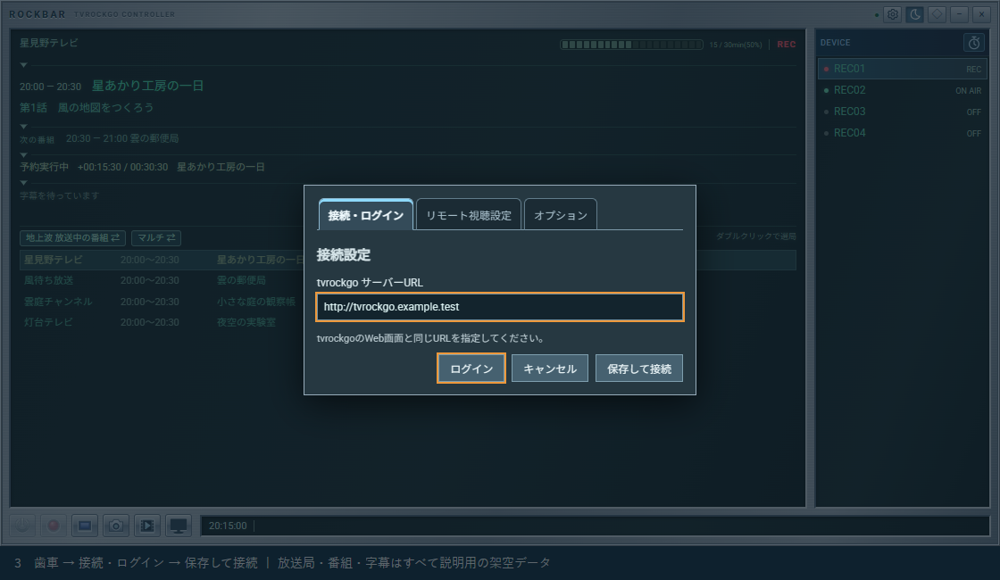
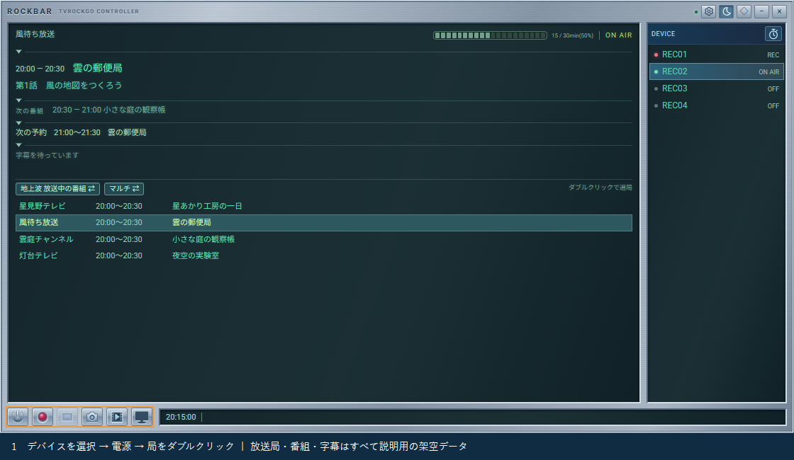
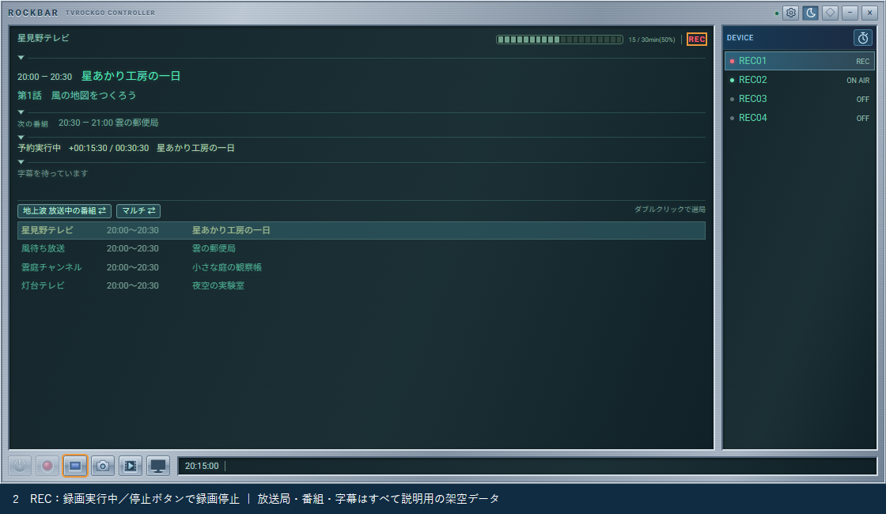
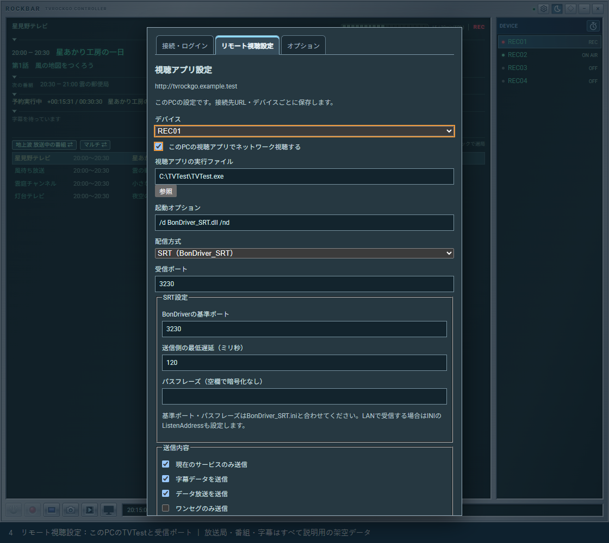
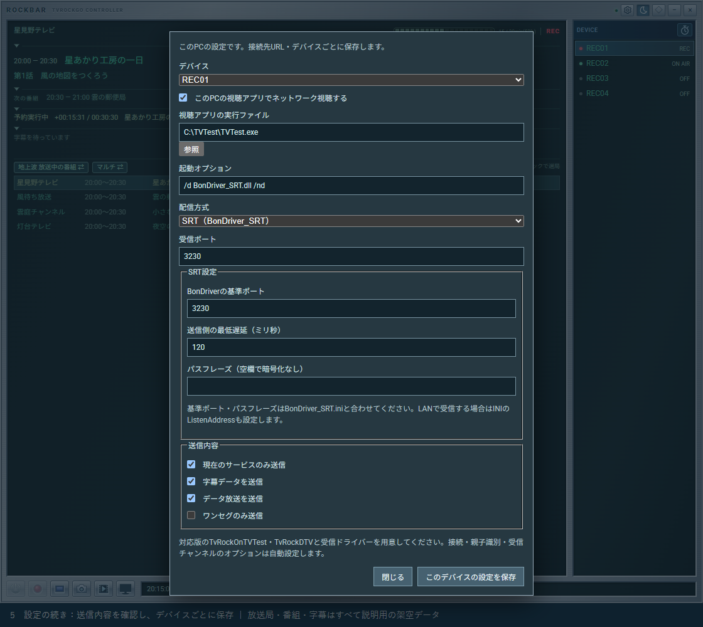
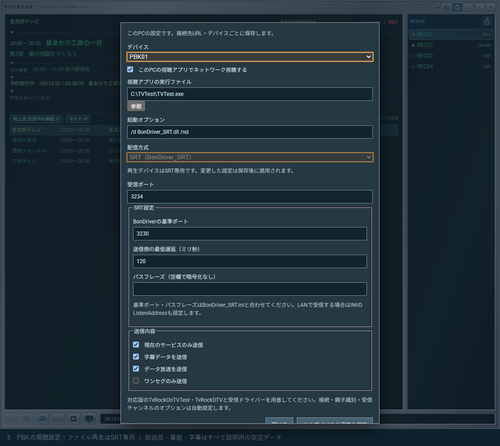
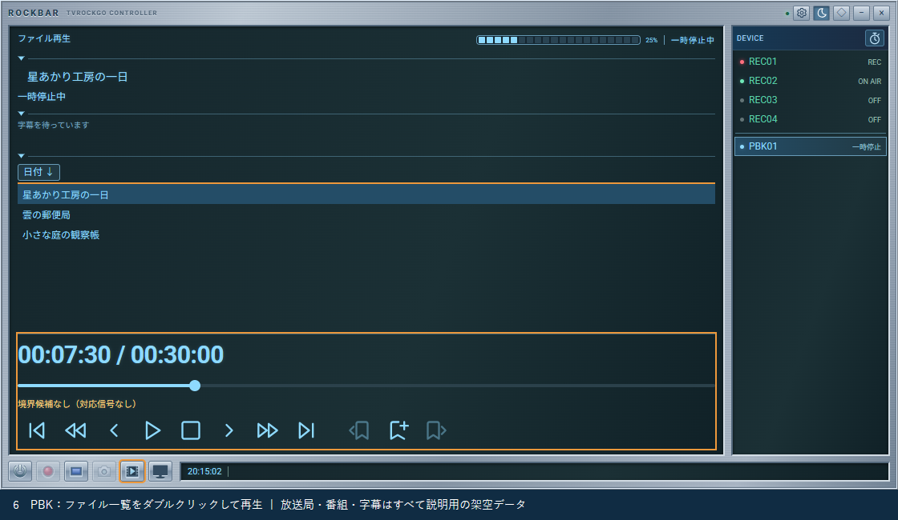
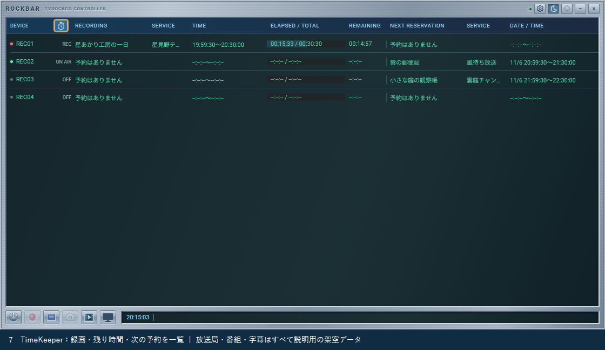

# Rockbarの使い方

RockbarはTvRockGOへ接続し、デバイスの起動・選局・ライブ録画や、録画状況の確認を行うコントローラーです。本書はWindows版（Electron版）を中心に説明します。ブラウザ版でも基本のデバイス操作はできますが、このPCのTVTestを起動するリモート視聴・ファイル再生はWindows版の機能です。

**画像にある放送局名・番組名・番組内容はすべて説明用の架空データです。** 実際のRockbar画面にサンプルを表示して撮影しており、局ロゴや実際の番組情報は使用していません。接続先URL・アプリパスも例示です。

## 目次

1. [TvRockGOへログインする](#1-tvrockgoへログインする)
2. [デバイスを選んで起動・選局する](#2-デバイスを選んで起動選局する)
3. [録画・停止ボタンでライブ録画する](#3-録画停止ボタンでライブ録画する)
4. [リモート視聴を設定して使う](#4-リモート視聴を設定して使う)
5. [ファイル再生を設定して使う](#5-ファイル再生を設定して使う)
6. [TimeKeeperで予約の実行状況を見る](#6-timekeeperで予約の実行状況を見る)

## 1. TvRockGOへログインする

1. Rockbarを起動し、右上の**歯車ボタン**を押します。
2. 「接続・ログイン」タブで、TvRockGOのWeb画面と同じサーバーURLを入力します。ポート番号を変えている場合は、それも含めます。
3. 認証を設定しているサーバーでは「ログイン」を押し、開いたログイン画面でユーザー名・パスワードを入力します。
4. ログインを終えたらRockbarに戻り、「保存して接続」を押します。
5. 上部の接続ランプやデバイス一覧を確認します。

Windows版はRockbar専用のログインセッションを使います。普段のブラウザでログイン済みでも、Rockbarでのログインが必要になる場合があります。パスワードはRockbarの設定ファイルには保存しません。

ブラウザ版はTvRockGOの`/static/rockbar/`を開いて使います。同じブラウザのログイン状態を利用し、接続先URLは自動設定されます。再ログインが必要な場合は、歯車の「ログイン」で開いた別タブでログインし、Rockbarへ戻ってください。

## 2. デバイスを選んで起動・選局する

### 2.1 画面の各部

| 場所 | 表示・操作 |
| --- | --- |
| 左上 | 選択中の局、現在の番組、次の番組、次の予約、字幕 |
| 左下の局一覧 | 受信できる放送局と放送中の番組。ダブルクリックで選局 |
| 右側のDEVICE | デバイス一覧。クリックで操作対象を選択 |
| 下部のボタン | 左から電源、録画開始、録画停止、キャプチャ、再生デバイス追加、番組表 |
| 下部の時計・ステータス | 時刻、選択デバイスの情報、処理状況やエラー |
| 上部の歯車 | 接続・ログイン、リモート視聴設定、オプション |
| 上部のスリープタイマーボタン | サーバー側のスリープタイマーの一時停止を切り替え。有効なサーバーで表示 |

### 2.2 デバイスを選択・起動

1. DEVICE一覧で、使いたいデバイスを**1回クリック**して選択します。
2. OFFの場合は下部左端の電源ボタンで視聴用アプリを起動します。デバイス欄のダブルクリックでも起動できます。
3. 録画用アプリとして起動したい場合は、OFFのデバイス欄、または電源ボタンを約600ミリ秒長押しします。
4. 起動が完了し、番組情報・状態が表示されるまで待ちます。

起動するアプリはサーバー側のデバイス設定によって決まります。リモート視聴を有効にしている場合の電源操作は、[後述の視聴開始・終了](#4-リモート視聴を設定して使う)に従います。

### 2.3 選局と表示の切り替え

1. 左側の局一覧で見たい放送局を探します。
2. 行を**ダブルクリック**します。キーボードの場合は行にフォーカスし、Enterを押します。
3. 左上の局名と現在番組が切り替わったことを確認します。

局の1回クリックは詳細の表示用で、選局はしません。録画中、OFF、起動途中、未接続などの状態では選局できません。

BS/CSや、対応する地上波/ワンセグのデバイスは、局一覧の見出しボタンで放送波の一覧を切り替えられます。一覧を切り替えた後、局のダブルクリックで実際に選局します。地上波・BSの「マルチ ⇄」はサブチャンネルを含める切り替えです。現在の局を見失ったときは、左上の局名をクリックすると一覧の該当位置へ戻れます。

現在番組・次番組・予約・字幕の区切り線にある矢印で、それぞれを折りたためます。番組タイトルをクリックすると内容を読めます。字幕欄をクリックすると、接続中に受信した直近の字幕履歴を表示します。

## 3. 録画・停止ボタンでライブ録画する

ライブ録画は、選択したデバイスが今受信している番組を、その場で録画する操作です。

1. 使用するデバイスを起動し、録画したい局へ選局します。
2. 現在の局と番組を確認します。
3. 下部の**丸い録画ボタン**を押します。
4. 状態が赤く点滅する「REC」になったことを確認します。
5. 録画を終えるときは同じデバイスを選び、**四角い停止ボタン**を押します。

録画中は選局や通常の電源OFFが制限されます。停止ボタンは録画を停止する操作なので、予約録画中に押すと、その録画も途中で止まります。終了時刻を指定して録画したい場合は、Webアプリの番組表から予約し、SCHEDULEで条件を確認してください。

黄色く点滅する「LIVE」は視聴のみの予約の状態です。録画ファイルを作成しているRECとは区別して確認します。

## 4. リモート視聴を設定して使う

リモート視聴は、TvRockGO側のデバイスが受信した放送をネットワークで送り、**Rockbarを動かしているPCの視聴アプリで見る**機能です。Rockbar自体が映像を表示するわけではありません。

### 4.1 視聴PCの設定

1. 視聴PCにTVTest、受信ドライバー、対応するTvRockOnTVTest・TvRockDTVを用意します。サーバー側も対応する録画・視聴アプリとDLLが必要です。
2. 歯車から**「リモート視聴設定」タブ**を開きます。現在の画面では、ウィンドウの「オプション」とは別のタブです。
3. 「デバイス」で、視聴に使う通常のデバイスを選びます。
4. 「このPCの視聴アプリでネットワーク視聴する」をONにします。
5. 「視聴アプリの実行ファイル」に、このPCのTVTestのパスを指定します。
6. 配信方式と起動オプション、受信ポートを設定します。
7. 「このデバイスの設定を保存」を押します。別のデバイスを使う場合は、デバイスごとに設定します。

| 設定項目 | 設定する内容 |
| --- | --- |
| 実行ファイル | 視聴PCにあるTVTestの絶対パス。例：`C:\TVTest\TVTest.exe` |
| 起動オプション | SRTの例：`/d BonDriver_SRT.dll /nd`。UDPでは対応するBonDriverを指定 |
| 配信方式 | SRTまたはUDP。受信側のドライバーと合わせます |
| 受信ポート | 他の同時視聴デバイスと重複しない値 |
| BonDriverの基準ポート | SRTのINIにあるBasePortと合わせます。既定3230 |
| 最低遅延・パスフレーズ | 利用するSRT構成に合わせます |
| 送信内容 | 現在のサービスのみ、字幕、データ放送、ワンセグなど、必要な範囲を選びます |

接続・親子識別・受信チャンネルのオプションはRockbarが追加します。`/host /pid /parent /DID /port`やSRTの受信チャンネル指定を手動で追加する必要はありません。TVTestの単一起動指定`/s`は使用しません。

設定は**このPCの接続先URL・デバイスごと**に保存されます。サーバー側のアプリパスと、視聴PC側のアプリパスを取り違えないでください。LAN側の受信許可やSRTの`ListenAddress`など、詳しい準備は[リモート視聴](remote-viewing.md)を参照してください。

### 4.2 電源ボタンで視聴を開始・終了

1. 設定済みのデバイスを選び、電源ボタンで「このPCで視聴を開始」します。
2. 視聴PCのTVTestが起動し、受信が始まるのを待ちます。
3. 必要に応じてRockbarの局一覧をダブルクリックして選局します。
4. 終了するときは電源ボタンで「このPCの視聴を終了」を行います。

録画中のデバイスも、リモート視聴の設定があれば**録画を続けたままライブ視聴**できます。録画中はチャンネルを変更できません。視聴の終了はこのPCの受信側を終了する操作で、録画は継続します。録画を残したい場合は、録画停止ボタンを押さないでください。

ライブ視聴は現在放送中の位置を見る操作です。録画の先頭から見たい場合は、次節のファイル一覧から追いかけ再生します。

## 5. ファイル再生を設定して使う

TvRockGOの録画ログに登録されているTSファイルを、PBKという専用の再生デバイスで視聴します。通常の録画デバイスとは別なので、チューナーを使った受信と分けて扱えます。

### 5.1 再生デバイスの準備

1. 歯車 →「リモート視聴設定」を開きます。
2. 「デバイス」で`PBK01`などの再生デバイスを選びます。未使用のPBKも、この設定画面から選べます。
3. このPCのTVTestのパスと起動オプションを指定します。
4. **再生デバイスはSRT専用**です。BonDriver_SRTを用意し、受信ポートと基準ポートなどを合わせます。
5. 通常のリモート視聴や他のPBKとポートが重複しないことを確認し、「このデバイスの設定を保存」を押します。

録画ファイルはサーバーから読み取れる必要があります。ローカルの任意ファイルをファイル選択ダイアログで開く機能ではありません。必要なDLL・プラグインなどは[TSファイル再生](playback.md)を参照してください。

### 5.2 再生デバイスを追加してファイルを選ぶ

1. 下部のキャプチャボタンの右にある**「再生デバイスを追加」**ボタンを押します。
2. 空いているPBKが追加・選択され、TVTestが受信待受状態で起動します。
3. 左側のファイル一覧でタイトルを選びます。並べ替えボタンで日付順・タイトル順を切り替えられます。
4. ファイルを**ダブルクリック**、または選択してEnterを押すと、そのPBKで再生します。待受中のPlayでも選択ファイルを再生できます。
5. 解析・準備の状況は下部のステータスで確認します。開始まで時間がかかる場合があります。

一覧には対象の録画済みファイルと録画中のファイルが表示されます。録画中のものを選ぶと追いかけ再生になり、記録済みの範囲内を移動できます。末尾に追いつくと録画の追記を待ちます。

Webアプリの「SETTING → 録画ログ」の再生ボタンから開始することもできます。この操作は、その時点で接続しているWindows版Rockbarそれぞれに再生を要求します。複数のRockbarが接続されている場合は対象範囲に注意してください。

### 5.3 再生中の操作と終了

| 操作 | 動作 |
| --- | --- |
| 再生位置スライダー | つまみを動かして離すと、その位置へ移動します |
| 先頭・末尾 | ファイルの先頭・末尾へ移動。追いかけ再生では記録済み範囲の末尾へ移動 |
| 30秒／15秒戻る・進む | 少し前を見直す、先へ移動する |
| 一時停止／再生 | その位置で一時停止・再開 |
| 停止 | ファイル再生を止め、PBKとTVTestを待受状態に戻します |
| 電源 | TVTestを終了し、PBKをデバイス一覧から外します |
| しおり＋ | 現在位置に手動しおりを付けます |
| 左右のしおりボタン | 前後のしおり・境界候補へ移動します |

**停止だけではPBKとTVTestは終了しません。使い終わったら、そのPBKを選んで電源ボタンを押します。** 別ファイルを見るだけなら、待受状態から次のファイルを再生できます。

途中停止した場合の視聴位置は保存され、次回はその位置から再開します。最後まで再生した場合は先頭に戻ります。しおりや境界候補の詳しい扱いは[TSファイル再生](playback.md)を参照してください。

## 6. TimeKeeperで予約の実行状況を見る

1. DEVICE見出し横の**TimeKeeper切り替えボタン**を押します。
2. 各デバイスの録画中タイトル・放送局・時刻・経過時間／総時間・残り時間を確認します。
3. 右側の「NEXT RESERVATION」で次の予約タイトル・局・開始予定を確認します。
4. 同じ切り替えボタンを押すと通常のデバイス表示に戻ります。

複数の録画が予定どおり進んでいるかをまとめて確認する画面です。画面が狭い場合はウィンドウを広げるか、一覧を横にスクロールして右側の項目を確認します。予約条件の変更はWebアプリのSCHEDULEやKEYWORDで行います。

TimeKeeperでも選択デバイスへの録画・停止などの操作ボタンは残るため、確認だけの場合は誤って停止しないようにしてください。PBKはこの一覧・台数集計には含まれません。TimeKeeperへ切り替えてもファイル再生は続き、通常表示へ戻すと使用中のPBKを再び確認できます。

番組を探して予約する手順は[Webアプリ・番組表の使い方](tvguide.md)、導入・接続の詳細は[README](../README.md)と[リモート視聴](remote-viewing.md)を参照してください。
