# Webアプリ・番組表の使い方

TvRockGOのWebアプリで、番組を探し、録画予約し、実行状況を確認するためのマニュアルです。TvRockGOへブラウザでアクセスし、認証を設定している場合はログインしてから操作します。録画には、サーバー側のデバイス・録画アプリ・保存先の設定と、番組情報の取得が必要です。導入は[README](../README.md)、サーバー設定は[設定ガイド](configuration.md)を参照してください。

**本書の画像にある放送局名・番組名・番組内容・字幕は、すべて説明用の架空データです。** 実際の画面にサンプルデータを表示して撮影しています。日時・番組情報の取得状況、画面幅、テーマ、設定によって表示は変わります。局ロゴは使用していません。

## 目次

1. [画面の見方と放送波の切り替え](#1-画面の見方と放送波の切り替え)
2. [日付・時間を移動する](#2-日付時間を移動する)
3. [番組を予約して実行状況を確認する](#3-番組を予約して実行状況を確認する)
4. [検索からキーワード予約を登録する](#4-検索からキーワード予約を登録する)
5. [サイドナビゲーションで新番組を探す](#5-サイドナビゲーションで新番組を探す)
6. [番組の字幕履歴を読む](#6-番組の字幕履歴を読む)
7. [過去番組を検索する・旧TvRockのデータを移行する](#7-過去番組を検索する旧tvrockのデータを移行する)
8. [スリープタイマーを操作する](#8-スリープタイマーを操作する)
9. [番組表・デバイスの表示を好みに合わせる](#9-番組表デバイスの表示を好みに合わせる)
10. [SETTINGのその他の項目](#10-settingのその他の項目)

## 1. 画面の見方と放送波の切り替え

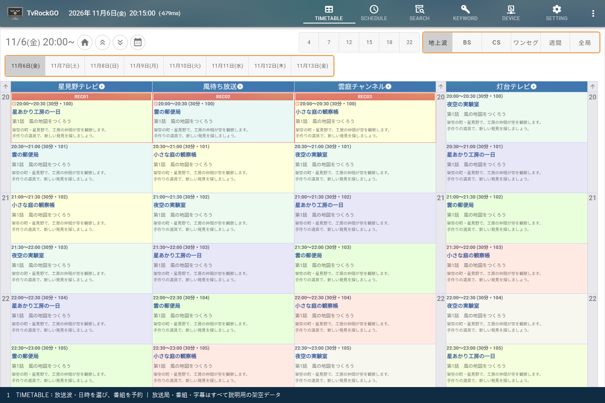

画面上部のタブで、操作する画面を切り替えます。

| タブ | 主な用途 |
| --- | --- |
| TIMETABLE | 放送局と日時を選び、番組表から予約する |
| SCHEDULE | 登録された個別の予約を確認・調整する |
| SEARCH | タイトルや内容で検索し、単発予約や検索予約を登録する |
| KEYWORD | 自動予約に使う検索条件を確認・調整する |
| DEVICE | デバイスの起動状態・受信番組・録画実行状況を確認する |
| SETTING | 表示、サービス、番組情報取得、録画、電源管理などを設定する |

TIMETABLE内の放送波ボタンで、次の表示に切り替えます。

| ボタン | 表示するもの |
| --- | --- |
| 地上波 | 地上波の主なチャンネル |
| BS | BSの主なチャンネル |
| CS | CSのチャンネル |
| ワンセグ | ワンセグのチャンネル |
| 週間 | 1つの局を日ごとに並べた週間番組表 |
| 全局 | 放送波をまとめた番組表 |

### 地上波・BSのマルチ表示

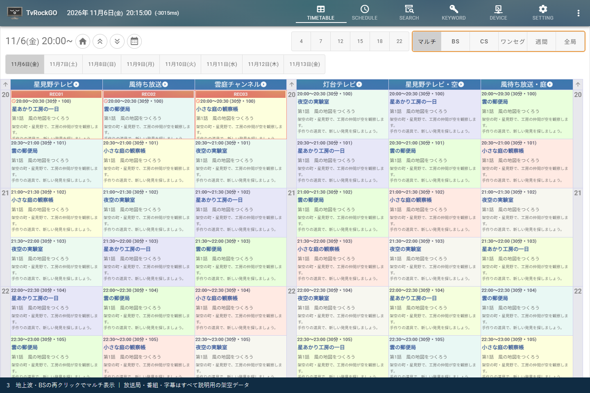

1. 「地上波」または「BS」を選択します。
2. **選択中の同じボタンをもう一度クリック**します。
3. ボタンが「マルチ」になり、サブチャンネルを含めて閲覧できます。
4. 「マルチ」をもう一度クリックすると通常表示に戻ります。

表示対象の局が多い場合は、ページ番号で続きを表示します。設定で非表示にしたサービスや、番組情報が未取得の局は、期待した番組が出ないことがあります。

### 週間表示

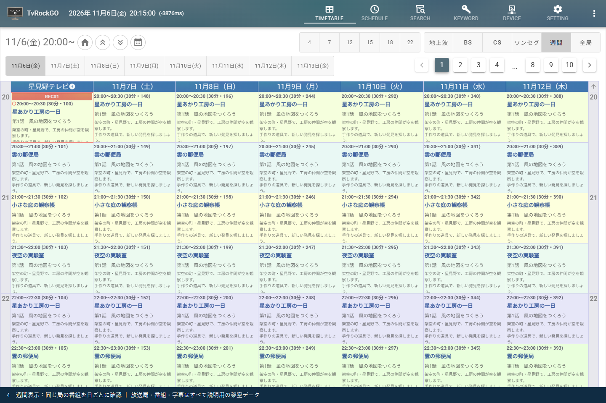

「週間」を選ぶと、1つの局の番組を日付の列で比較できます。局名の見出しからその局の週間表示へ移ることもできます。週間表示中のページ番号は表示する局の切り替えに使います。同じ時間帯の連続番組や、曜日ごとの編成を確認したいときに便利です。

## 2. 日付・時間を移動する

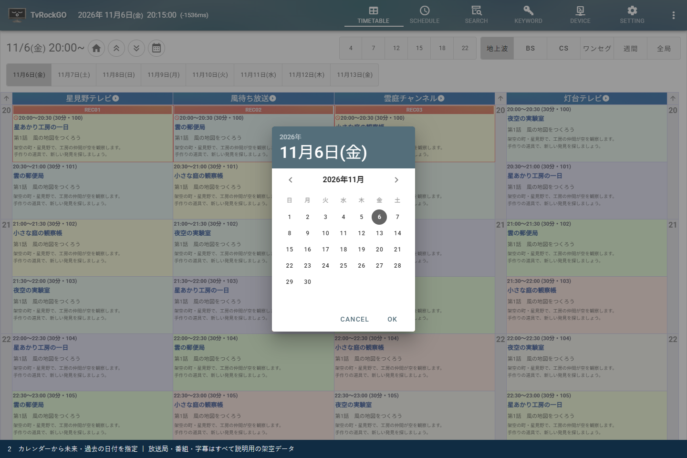

| 操作箇所 | 使い方 |
| --- | --- |
| 日付ボタン群 | 表示したい日を選択します。近い日付を続けて見るときに使います |
| 時間帯ボタン群 | 見たい時刻を選択し、その時間帯へ移動します |
| 家のアイコン | 現在の時間へ戻ります |
| 上下の二重矢印 | 前・次の時間帯へ移動します |
| カレンダーボタン | 日付を選択し「OK」で確定します。「Cancel」は取り消しです |
| 番組欄のスクロール | 前後の時間帯を連続して閲覧します |

未来の番組は取得済みの番組情報がある範囲、過去の番組は保存・移行済みの範囲を閲覧できます。日付を選べても、その日のデータがなければ番組欄は空になります。遠い過去へ移動するときはカレンダーを使ってください。

「放送波・時間帯を横に表示」を有効にしている場合、選択ボタン群は番組表の横に配置されます。28時間表記を有効にしている場合は、深夜が24～27時などの表記になります。

## 3. 番組を予約して実行状況を確認する

**TIMETABLEで番組を選ぶ → 録画予約 → SCHEDULEで確認 → DEVICEで実行確認**、という流れです。

### 3.1 TIMETABLEから録画予約

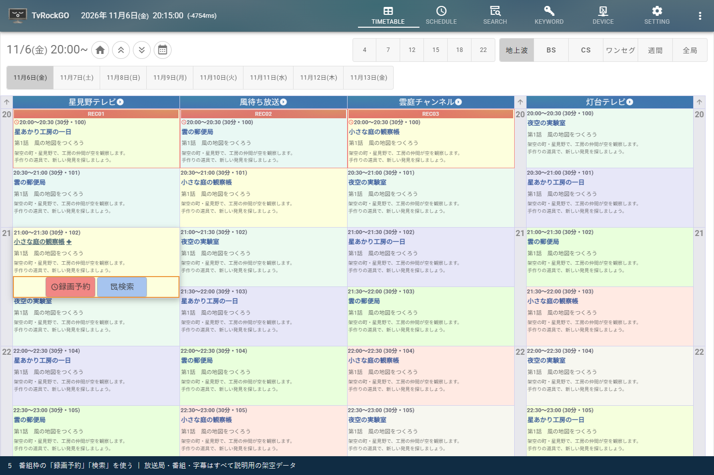

1. 放送波・日付・時間を選び、録画したい番組を探します。
2. 番組枠をクリックして詳細と操作ボタンを表示します。マウスオーバーやポップアップに設定している場合は、その表示方法に従います。
3. **「録画予約」**を押します。
4. 番組枠の予約表示・デバイス名などを確認し、SCHEDULEへ進みます。

放送中の番組は残り時間からの録画となり、すでに終了した番組の録画予約はできません。「視聴予約ボタンを表示」を有効にすると「視聴予約」も使えます。視聴予約は録画ファイルを作る録画予約とは用途が異なります。

予約済みの番組では、状態に応じて「予約削除」「予約無効」「録画停止」などの操作に変わります。検索予約から作られた予約を継続的に変更したい場合は、KEYWORD側の検索条件も確認してください。

### 3.2 SCHEDULEで予約を確認

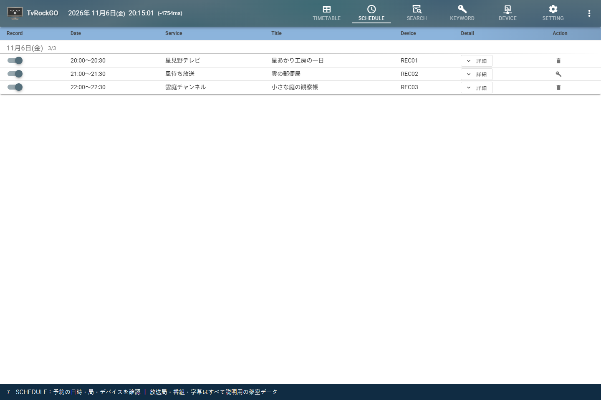

1. 上部の「SCHEDULE」を開きます。
2. 対象番組の有効スイッチ、放送日時、放送局、タイトル、割り当てデバイスを確認します。
3. 調整が必要なときは、その行の「詳細」を開きます。開始・終了の余裕時間や録画条件などを確認できます。

SCHEDULEタブを再クリックすると、日時順とデバイス別の表示を切り替えられます。予約が多い場合は、日付単位・デバイス単位で確認すると見落としを減らせます。ここで予約が表示されることと、録画が実行できたことは別なので、開始時刻にはDEVICEも確認します。

### 3.3 DEVICEで録画の実行状況を確認

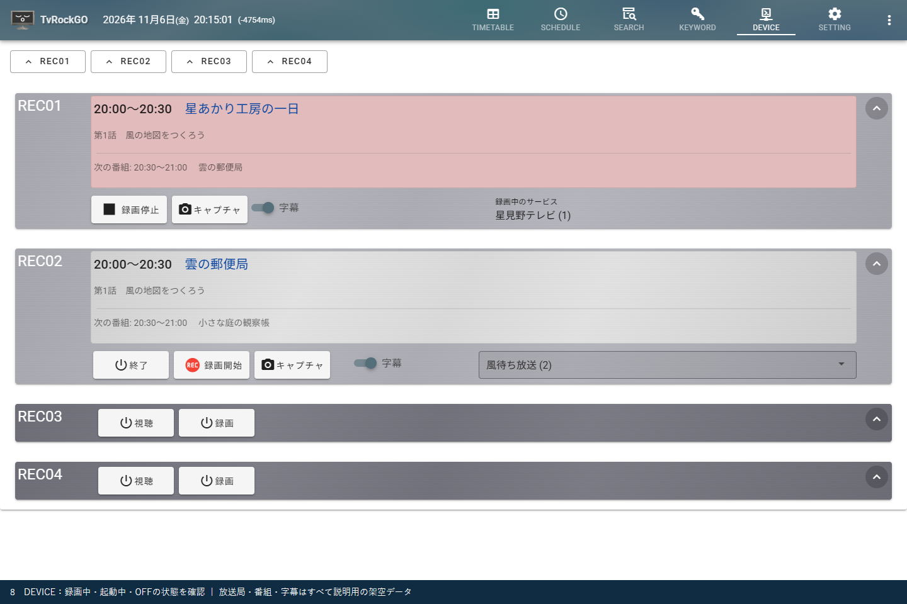

「DEVICE」で、SCHEDULEに表示されたデバイスを探します。現在受信している番組、録画中の表示、停止ボタンなどから実行状況を確認します。予定時刻になってもOFFのまま、または起動途中のままの場合は、サーバー側のデバイス・外部アプリの設定とシステムログを確認してください。

録画終了後の結果は「SETTING → 録画ログ」で確認できます。録画を途中で止める操作は、対象デバイス・対象番組を確かめてから行ってください。

## 4. 検索からキーワード予約を登録する

毎回の放送を探して予約したい場合は、検索条件を登録する「検索予約」を使います。

### 4.1 番組の検索ボタンからSEARCHへ

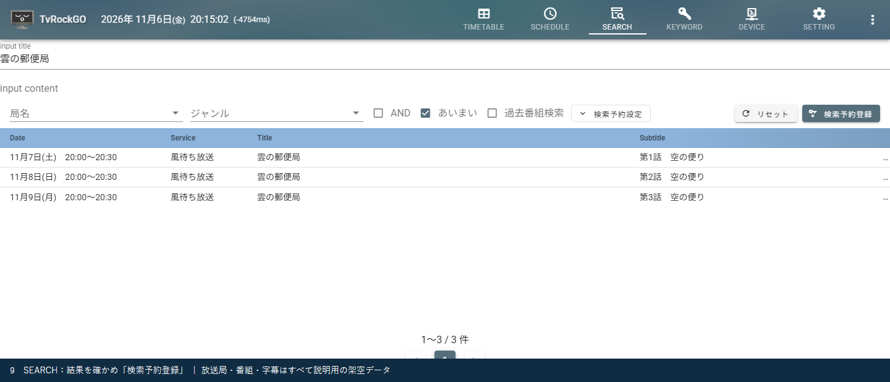

1. TIMETABLEで対象番組の詳細を表示し、「検索」を押します。
2. SEARCHへ移動し、番組タイトルを元にした検索結果を確認します。
3. `input title`（タイトル）や`input content`（内容）を調整します。毎回変わる話数や副題などを除き、シリーズ共通の語句にすると探しやすくなります。
4. 必要に応じて局名・ジャンル・AND・あいまい検索などを設定し、意図した番組が見つかるか確かめます。

結果一覧の「録画予約」は、その番組1件を予約する操作です。検索条件を継続して使う場合は、次の登録を行います。

### 4.2 検索予約を登録してKEYWORDで確認

1. 「検索予約設定」を開き、曜日・検索日数・デバイス・録画条件などを確認します。
2. **「検索予約登録」**を押して条件を登録します。既存の条件を編集している場合は「検索予約保存」になります。
3. 「KEYWORD」を開き、登録した条件が有効になっていることを確認します。
4. 条件に合って作られた個別予約は「SCHEDULE」で確認します。

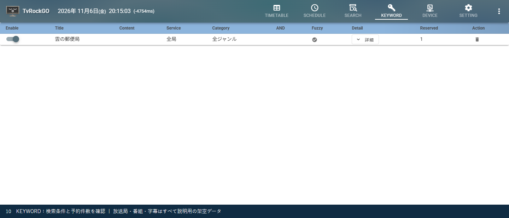

KEYWORDには検索条件、SCHEDULEには個別の予約が表示されます。KEYWORDの「Reserved」は、その条件に結び付いた予約件数の確認に使います。0件のときは、まだ対象期間の番組情報がない場合や、条件が厳しすぎる場合があります。「詳細」で条件を調整し、行を選んで検索結果を見直します。

**TIMETABLEの「検索」を押しただけでは、検索予約は登録されません。** SEARCHの結果確認と「検索予約登録」まで行ってください。

## 5. サイドナビゲーションで新番組を探す

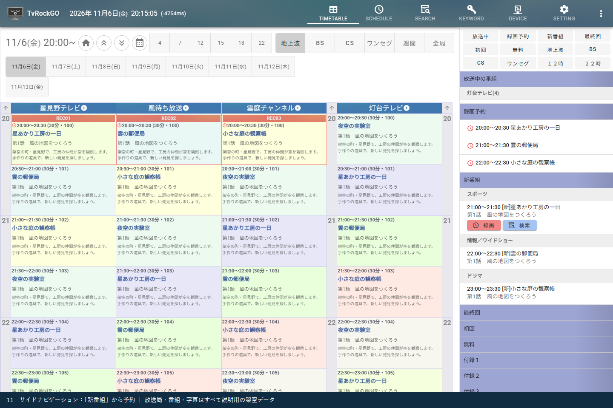

1. 上部右端の縦三点ボタンでサイドナビゲーションを表示します。
2. 上部の「新番組」を押し、その一覧へ移動します。
3. タイトル・日時・局・副題を確認します。気になる番組にマウスを重ねると操作ボタンが現れるので、「録画」を押します。
4. シリーズを継続して予約したい場合は、その番組の「検索」からSEARCHへ進み、検索予約を登録します。
5. 「SCHEDULE」または「KEYWORD」で登録結果を確認します。

一覧の番組を選ぶと、対応する番組表の位置を確認できます。「最終回」「初回」「無料」などの一覧も併用できます。改編期には、新番組一覧と番組表を見比べながら予約すると便利です。分類は取得できた番組情報に基づくため、一覧だけですべての新番組を網羅するとは限りません。

## 6. 番組の字幕履歴を読む

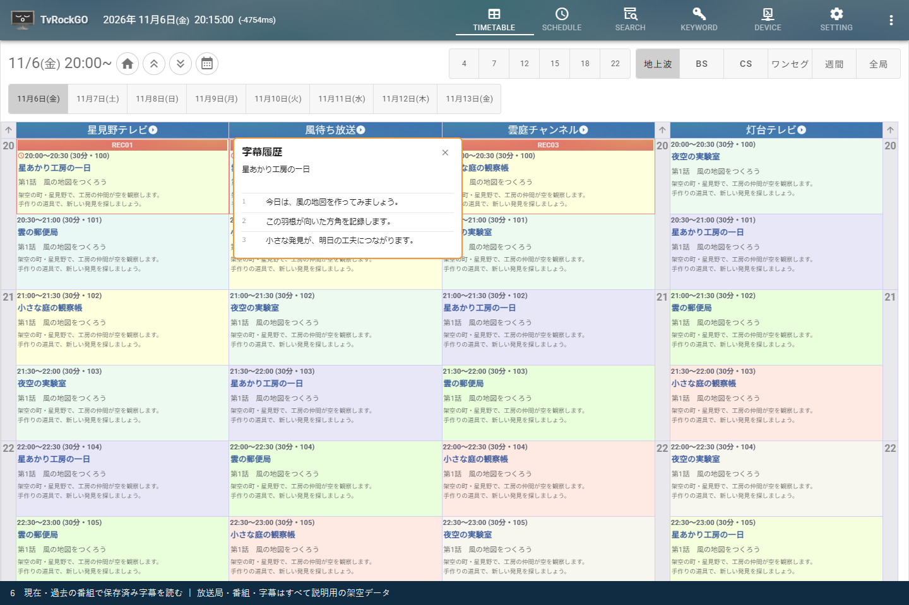

1. 「SETTING → 番組表」の「番組クリック時に字幕履歴を表示」をONにします。
2. TIMETABLEで現在または過去の番組を選びます。
3. 標準のクリック表示では、1回目で詳細を開き、同じ番組をもう一度クリックすると字幕履歴を開きます。
4. 履歴をスクロールして読みます。続きがある場合は「続きを表示」などで読み込みます。
5. 閉じるボタンやEscapeで閉じます。番組欄表示アクションの設定によって、詳細表示と履歴を開く操作は変わります。

未来の番組には字幕履歴はありません。現在・過去の番組でも、字幕が送出されていない場合や、サーバーに字幕が保存されていない場合は閲覧できません。番組情報の保存と字幕の保存は別です。旧TvRockの番組データを移行しても、字幕が新しく生成されるわけではありません。

## 7. 過去番組を検索する・旧TvRockのデータを移行する

### 7.1 保存された番組を探す

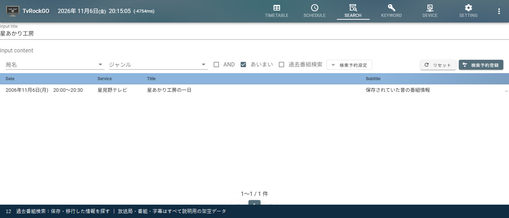

1. 「SEARCH」でタイトルや内容を入力します。
2. **「過去番組検索」**をONにします。
3. 「詳細設定」で検索開始日・検索終了日を指定し、対象期間を絞ります。
4. 結果の日時・局・タイトルを確認します。結果の番組を選ぶと、番組表の対応する日時を確認できます。
5. 字幕から探す場合は「字幕」を使います。保存された字幕がある範囲が対象です。

過去の検索結果から、終了済み番組を新しく録画することはできません。また、番組情報が残っていることは、録画ファイルが残っていることを意味しません。

### 7.2 旧TvRockの蓄積データを取り込む

旧TvRockで「番組データをテキストで保存する」を有効にして使い続けていた場合、蓄積した情報をTvRockGOへ取り込めます。  
取り込み対象は、***`dtv.ini`と`timemachine`フォルダが入っている旧TvRockの(MyDocument)フォルダ***です。

1. TvRockGOサーバーを終了し、DBをバックアップします。
2. 既存のTvRockGOの設定と局情報が用意されていることを確認します。
3. TvRockGOの配置先でPowerShellを開き、次の例の取り込み元を自分の環境に置き換えて実行します。

```powershell
Start-Process -FilePath .\tvrockgo.exe -ArgumentList '--timemachine "C:\Import\tvrock"' -NoNewWindow -Wait
```

4. 取り込み完了後、通常どおりTvRockGOを起動します。
5. SEARCHの過去番組検索、またはTIMETABLEのカレンダーで、取り込んだ期間を確認します。

取り込み中はCtrl+Cで中断できます。中断時はファイルとDBを閉じて終了し、それまでに保存済みの番組情報は残ります。  
取り込み元にサービスIDがない地上波の局は登録済みの同じ物理チャンネルの有効な局から親局を優先して照合します。同じ条件の候補が複数ある場合は局IDの小さいものを使用します。  
これは番組情報の取り込みです。録画ファイルや旧TvRockの設定・録画予約を一括移行するコマンドではありません。

`--timemachine`は取り込み後に終了する専用モードです。Ctrl+Cで中断した場合も、保存済みの情報は残ります。録画ファイル・設定・録画予約をまとめて移すコマンドではありません。保存してきた期間によっては、**20年近くにわたる番組情報**を検索・番組表で振り返ることもできます。閲覧できる範囲は元データと局の照合結果によって変わります。

## 8. スリープタイマーを操作する

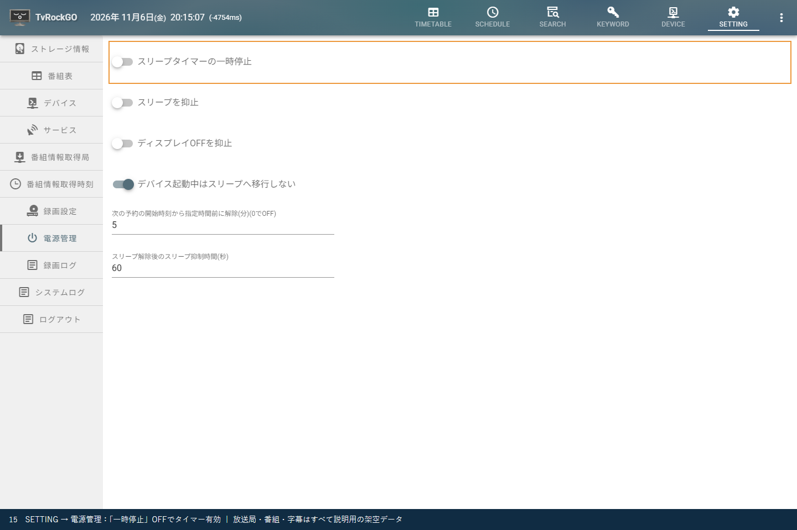

サーバーの`conf/tvrock.yml`で、次の設定が有効な場合に使用できます。設定ファイルを編集する場合はサーバーを終了してください。

```yaml
powermanagersetting:
  powermanager: true
```

「SETTING → 電源管理」で**「スリープタイマーの一時停止」**を切り替えます。

| 一時停止スイッチ | 動作 |
| --- | --- |
| OFF | スリープタイマーが働きます。予約がない時間帯に、設定された待ち時間と抑止条件に従ってスリープします |
| ON | スリープタイマーの機能を一時停止します。作業などで起動したままにしたいときに使います |

「ONにするとスリープする」という意味ではありません。**一時停止がOFFのときに、タイマーが有効**です。ONへ切り替えても、その場でPCをスリープさせる操作にはなりません。

次の予約前に復帰させるには、「次の予約の開始時刻から指定時間前に解除(分)」を設定します。0は復帰設定OFFです。予約の少し前に復帰し、録画の準備時間を確保します。OSの復帰タイマー設定や機器の対応状況にも依存します。「スリープを抑止」「デバイス起動中はスリープへ移行しない」などの条件によって、タイマーが有効でもスリープしないことがあります。

### アイコンからのショートカット

番組表の左上にある**TvRockGOアイコンをクリック**すると、一時停止をON/OFFできます。Rockbarでは上部の専用スリープタイマーボタンで同じ設定を切り替えます。サーバーの設定なので、変更は他の接続画面にも反映されます。

## 9. 番組表・デバイスの表示を好みに合わせる

### 9.1 SETTING → 番組表

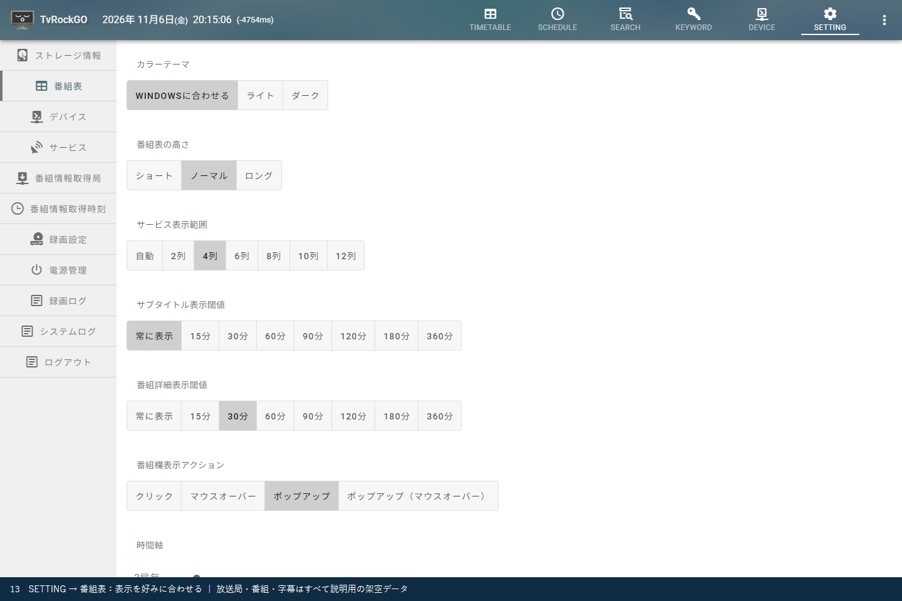

| 項目 | 調整できること |
| --- | --- |
| カラーテーマ | Windowsに合わせる／ライト／ダーク |
| 番組表の高さ | ショート／ノーマル／ロング。短い番組を読みたい場合は高く、一覧性を優先する場合は低くします |
| サービス表示範囲 | 自動、または表示する局の列数 |
| サブタイトル表示閾値・番組詳細表示閾値 | 番組の長さに応じて、枠内の文章をどこまで表示するか |
| 番組欄表示アクション | クリック、マウスオーバー、ポップアップなどの詳細の開き方 |
| 時間軸 | 何局ごとに時刻の目盛りを入れるか |
| 局ロゴ表示 | 取得済みの局ロゴを表示するか |
| 28時間表記 | 深夜を前日から続く24～27時などの表記にするか |
| 放送波・時間帯を横に表示 | 選択ボタン群を番組表の横に配置するか |
| 番組クリック時に字幕履歴を表示 | 番組から字幕履歴を開くか |
| 視聴予約ボタンを表示 | 録画予約のほかに視聴予約の操作も表示するか |
| 番組欄のジャンル色 | 通常・週間番組表の番組欄の背景色をライト・ダーク別に調整する |

下の方の項目は設定欄をスクロールして表示します。画面幅が狭い端末では局数を減らし、詳細表示をポップアップにするなどして調整できます。

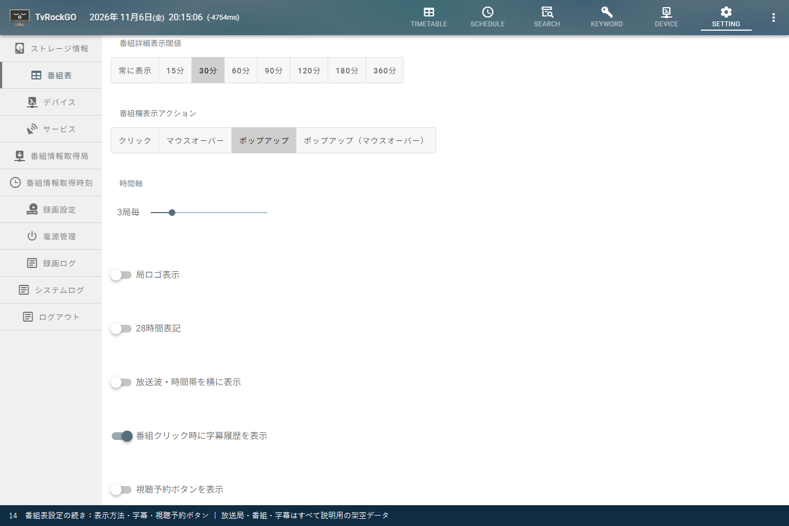

### 9.2 SETTING → デバイス

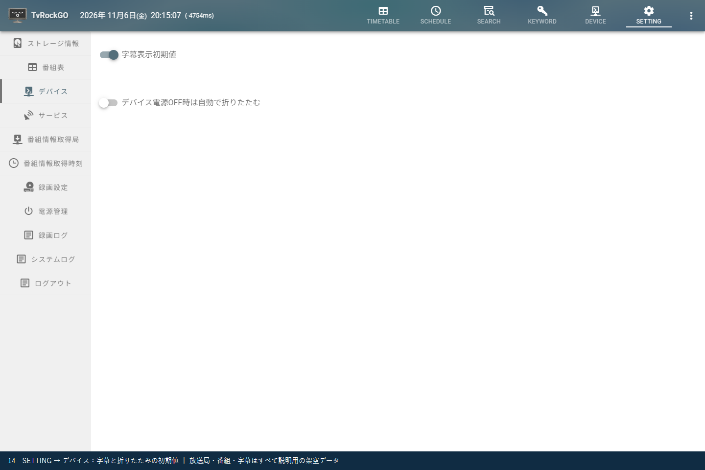

| 項目 | 用途 |
| --- | --- |
| 字幕表示初期値 | DEVICE画面で字幕を表示する初期状態を決めます |
| デバイス電源OFF時は自動で折りたたむ | 未使用デバイスをコンパクトにし、動作中のデバイスを見やすくします |

DEVICEのデバイス名ボタンから、個別の展開・折りたたみもできます。

**「番組表」と「デバイス」の表示設定は、使用中のブラウザのCookieに保存されます。TvRockGOサーバーの運用設定としては保存されません。** 別のブラウザ・別のPCには自動で引き継がれず、Cookieの削除などで初期状態に戻ることがあります。自分が使うブラウザごとに調整してください。

## 10. SETTINGのその他の項目

同じSETTINGの左側に、次の項目があります。番組表・デバイスの表示設定とは異なり、録画や番組情報取得などの項目はサーバーの動作にも関わります。

| 項目 | 何をするものか |
| --- | --- |
| ストレージ情報 | 録画先の容量・空き領域などを確認します |
| サービス | 各放送局のサービス情報、表示対象などを確認・設定します |
| 番組情報取得局 | 番組情報を取得する局を選びます |
| 番組情報取得時刻 | 定期的に番組情報を取得する時間を設定します |
| 録画設定 | 予約の基本動作、録画後のTS解析など、録画に関する共通設定を行います |
| 電源管理 | 自動スリープの一時停止、スリープ抑止、予約前の復帰などを設定します。有効時のみ表示されます |
| 録画ログ | 終了した録画の結果を確認します。対応するWindows版Rockbarでファイル再生する入口にもなります |
| システムログ | 起動・接続・処理・エラーなどの状況を調べます |
| ログアウト | Webアプリのログイン状態を終了します |

録画・視聴のコントローラーは[Rockbarの使い方](rockbar.md)、詳しい設定値は[設定ガイド](configuration.md)、再生の準備は[TSファイル再生](playback.md)を参照してください。
