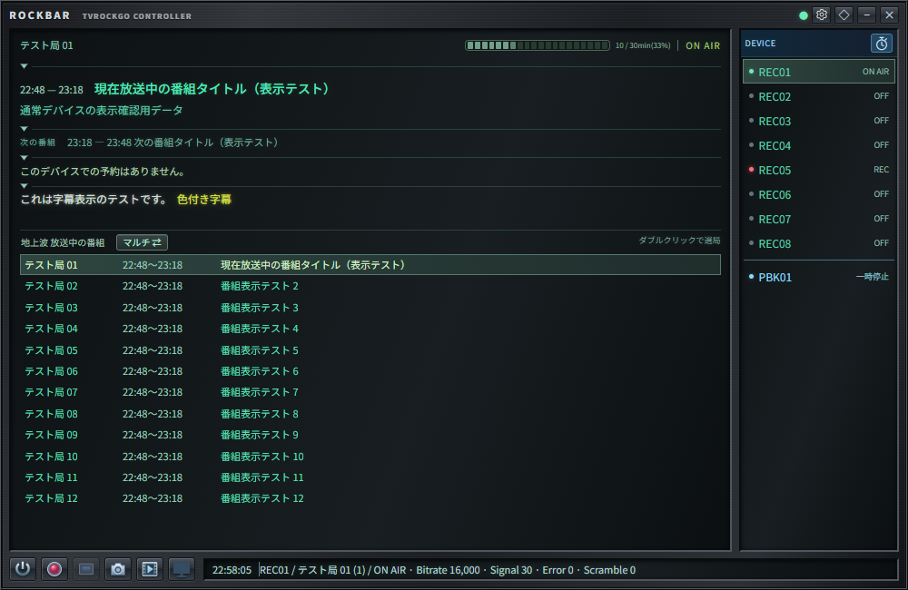
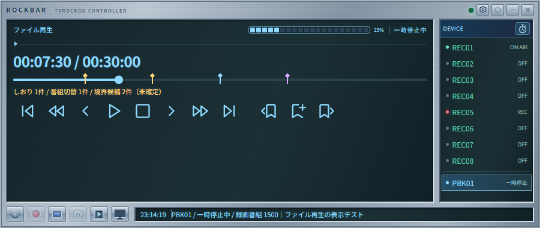
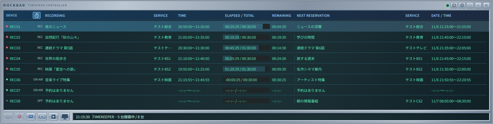

# Rockbar



TvRockGOを操作するコントローラーです。同じ画面と通信処理から、Windows用の独立したElectronアプリと、TvRockGOで配信するブラウザ版の2種類を作成できます。Electron版は画面・画像をexeに同梱します。

Windowsのアプリモードがダークのときは、黒を基調にした金属調の外観になります。ライトモードでは従来の銀色の外観を使用します。起動中のテーマ変更にも自動で追従します。ブラウザ版はブラウザが通知するOSのカラーテーマに従います。

キャプチャの右にあるテレビ型ボタンで番組表を開けます。デスクトップ版では、ログイン済みのセッションを共有するサイズ変更可能な専用ウィンドウを表示／非表示にします。非表示中もページの状態を保持します。ブラウザ版では新しいタブで番組表を開きます。接続先を変更すると専用ウィンドウを閉じ、次回は新しい接続先の番組表を表示します。

現在番組のタイトル・サブタイトルや選局一覧の局欄は、クリックで番組詳細を表示／非表示にします。ホバー表示も残しており、マウスを1分以上合わせるかキーボードで1分以上フォーカスすると詳細を表示します。閉じているときにタイトル・サブタイトルや局の行をクリックすると、すぐに詳細を固定表示し、他の局を通過しても表示が切り替わらず、長い本文をスクロールして読めます。ポップアップの外側をクリックすると、表示元や別の局の行でも必ず閉じ、そのクリックでは開き直しません。Escapeでも閉じられます。局のダブルクリック／フォーカス中のEnterでは詳細を閉じて選局します。本文のHTTP・HTTPS URLをクリックすると、デスクトップ版では既定のブラウザ、ブラウザ版では新しいタブで開きます。専用の番組表ウィンドウでも、番組詳細のURLやタイトルの検索リンクは既定のブラウザで開きます。

「現在の番組」「次の番組」「次の予約」「字幕」は、各欄の上の区切り線にある矢印で折りたためます。「現在の番組」を閉じると、その内側の「次の番組」「次の予約」「字幕」も区切り線ごと非表示になります。再び開くと、内側の各欄はそれぞれの開閉状態を保って表示されます。下向きは展開中、右向きは折りたたみ中です。キーボードでは区切り線にフォーカスしてEnterまたはSpaceで切り替えられます。開閉状態はローカルストレージに保存します。

## 開発・exeの作成

Node.js 22以上を使用し、このフォルダで実行します。

```powershell
npm ci
npm start
npm test
npm run build
```

## 2つのビルドターゲット

リポジトリの`rockbar/`で実行します。

| コマンド | 出力 |
| --- | --- |
| `npm run build:electron` | `rockbar/dist/Rockbar-Setup-1.0.0-x64.exe` |
| `npm run build:web` | `static/rockbar/`（リポジトリルート基準） |
| `npm run build:all` | ブラウザ版とexeの両方 |

従来の `npm run build` はexeビルドの別名です。ブラウザ版だけならElectronのダウンロードは不要で、Node.jsで `npm run build:web` を実行できます。

ブラウザ版はTvRockGOの起動後、[http://localhost/static/rockbar/](http://localhost/static/rockbar/) を開いてください。別のPCやポートの場合はTvRockGOのアドレスに置き換えます。`index.html` のファイル直接起動には対応しません。

ブラウザでTvRockGOにログイン済みなら、そのCookieをそのまま使います。初回にログイン画面へ転送された場合は、ログイン後に上記RockbarのURLをもう一度開いてください。利用中に再ログインが必要になった場合は、設定の「ログイン」で別タブを開き、ログイン後にRockbarタブに戻ります。

ブラウザ版は配信元のTvRockGOに自動接続するため、接続先URLは読み取り専用です。最前面固定・最小化・終了はブラウザのウィンドウ操作を使います。画面はブラウザのサイズに追従します。

`app` の `npm run build` は `static/` を作り直すため、両方を更新するときは **appのビルド → rockbarの `npm run build:web`** の順に実行してください。Rockbarのブラウザビルドは `static/rockbar/` のアセットだけを書き込み、既存appのファイルは変更しません。

`dist/Rockbar-Setup-1.0.0-x64.exe` はWindows x64用のNSISインストーラーです。実行してインストール後、スタートメニューから起動します。Windowsの「インストールされているアプリ」からアンインストールできます。ユーザー設定は更新・アンインストール時にも保持します。新しいバージョンのインストーラーを実行すると既存のNSIS版を更新します。実行先にNode.jsは不要です。ビルド時はElectronなどの取得にインターネット接続が必要です。

## Web版のmanifestとアイコン

`web/manifest.json` にアプリ名・起動URL・表示モードを設定します。アイコンは `web/icons/rockbar192x192.png`（192×192）と `web/icons/rockbar.png`（512×512）を使用します。ブラウザのfaviconとApple用アイコンには192×192の画像、Chromeでアプリとしてインストールする際にはmanifestに指定した両サイズの画像が使われます。exe用アイコンを変更した場合、Web用PNGも別途更新してください。

`npm run build:web` で `static/rockbar/` にコピーされ、Web版HTMLにmanifest・favicon・Apple用アイコンの参照が追加されます。出力先を直接編集すると次のビルドで上書きされるため、変更は `web/` に行います。

対応ブラウザの「アプリをインストール」などから独立ウィンドウとして利用できます。PWAのインストールにはHTTPS、またはlocalhost等のローカル環境が必要です。LAN内のIPアドレスへの通常のHTTPアクセスはこの条件を満たしません。オフライン対応は含まず、利用時にはTvRockGOとの接続が必要です。

iOS版はTvRockGO、RockbarのURLから「ホーム画面に追加」でそれぞれアプリとして登録でき、専用のアイコンを用意しています。


## 操作

- DEVICE見出し右端のストップウォッチアイコンで「デバイス・選局モード」と「タイムキーパーモード」を切り替えます。デバイス枠が左へ広がり、全デバイスの録画中の番組・局・時間・録画時間／総時間・残り時間と次の予約を、枠線のない一覧に表示します。もう一度押すと元の画面へ戻ります。幅が足りない場合は一覧を横スクロールできます。
- タイムキーパーの時間は予約の録画開始・終了余裕時間を含み、サーバー時刻で毎秒更新します。実行中予約の状態は初回接続・再接続と予約変更通知で取得します。時間表示は受信したサーバー時刻を基準に内部時計で進めます。予約一覧の割当先が変わった場合も、実行中予約IDと受信中の局・番組、またはサーバーが返す実際のデバイス別予約で照合します。日をまたぐ終了時刻は `24:30:00` のように表示します。予定終了後も録画中なら経過時間はカウントを続け、残り時間はゼロになります。予約一覧の取得失敗だけでは実行中予約に基づくカウントを消しません。照合できない録画は番組名を表示し、時間は未取得表示になります。非表示モードの描画・スクロールアニメーションを停止し、タイムキーパー中は選局一覧の番組取得・字幕購読も停止します。デバイス状態と予約の取得、下部の操作ボタンは両モードで共有します。
- 右上の歯車からTvRockGOのWeb画面と同じサーバーURLを指定します。初期値は `http://localhost` です。
- 歯車の「カラーテーマ」タブで「Windowsに合わせる・ライト・ダーク」を選択できます。初期値は「Windowsに合わせる」で、OSの配色変更にも追従します。変更はすぐに反映され、選択デバイスと同様にRockbarのローカルストレージへ保存します。Electron版・ブラウザ版の両方で利用でき、番組表の設定とは独立しています。
- 停止ボタンは録画と実行中の視聴予約を停止します。予約なしの通常視聴では無効です。
- タイムキーパーでは `StartTime - IdleTime` から予約をRECORDING欄へ表示します。`StartTime - ReadyTime` まではELAPSEDをマイナスでカウントし、待機開始時にはNEXT RESERVATIONのタイトルを左へ移すアニメーションを表示します。動きを減らす設定では即時に切り替えます。
- 歯車の右隣の月ボタンでスリープタイマーをON/OFFに切り替えます。点灯時はON、消灯時は一時停止中です。電源管理が無効なサーバーでは表示しません。設定画面での変更は電源設定の更新通知で反映します。
- 右側のデバイスを選択すると、左側に現在番組の時刻・タイトル・説明と次の番組を表示します。
- 上部の放送局名をクリックすると、現在の放送局が選局一覧の中央に来るようにスクロールします（Enter／Spaceでも操作できます）。一覧の端では上端・下端まで移動し、全局が収まる場合はスクロールしません。別の放送波や通常表示で該当局が隠れている場合は、現在の放送波・必要なマルチ表示へ切り替えます。
- 局名の右に控えめな緑色の20区切りバーと `20 / 60min(33%)` 形式の進行時間を表示します。各目盛りは、その区間の進行に合わせて暗い色から明るい色へ徐々に変化します。サーバー時刻を基準に毎秒更新し、番組情報・時刻が未取得の場合、電源OFF・未接続時は非表示にします。
- 左下の画像ボタンは順に、電源ON/OFF、録画開始、録画停止、キャプチャです。電源OFF時はクリックで視聴デバイス(1)、約600msの長押しで録画デバイス(2)を起動します。録画デバイスの起動と録画開始は別操作です。
- 録画中の電源OFF、未起動時の録画操作、未接続時の操作は無効です。録画停止は選択デバイスの実際の録画を停止します。
- キャプチャはTvRockGO経由で依頼します。リモート視聴中は同じデバイスを視聴する各PCのTVTestが対象となります。受信準備が完了した視聴PCがない場合は録画対象アプリに依頼します。画像の保存場所は対象アプリの設定に従います。
- 下部にサーバーの現在時刻と、サービス名・サービス番号・ビットレート・信号・エラー・スクランブル値を表示します。受信値の単位はAPI側で規定されていないため、加工せず表示します。未取得値は `—` です。
- 外枠でサイズ変更、上部と周囲の金属調の余白で移動、◇で最前面固定、−で最小化、×で終了できます。番組・字幕・一覧・操作パネル内では通常のクリックや文字選択を使用します。スクロール情報はクリックで先頭に戻して停止し、もう一度クリックすると再開します。
- 接続切断後は3秒ごとに再接続します。URLとウィンドウ位置・サイズはElectronのユーザーデータフォルダに、選択デバイスはローカルストレージに保存します。
- 番組タイトルのスクロールは、取得済みの番組の開始時刻が切り替わったときだけ行います。同じ番組のタイトル・説明の補完や終了時刻の修正、局名の更新は、その場で表示を更新します。

## 通信・実装

`GET /dvs` と `GET /stl` で初期情報を取得し、`/con` のWebSocketの `dev:` を反映します。10秒ごとに `REL:` で全デバイスの状態を再取得します。操作は `BDV:` / `COM:` / `REQ:` を使います。サーバー側のクライアント識別値検証に対応したビルドを使用してください。

Electron版の通信はメインプロセスに限定し、操作画面はローカルHTMLを表示します。ログイン専用ウィンドウだけが指定サーバーのログインページを表示します。contextIsolationとsandboxを有効にし、Node.jsや任意URL取得を画面に公開しません。[Electronのセキュリティ指針](https://www.electronjs.org/docs/latest/tutorial/security)に沿った構成です。

`src/client.js`・`src/protocol.js`・`src/programs.js`・画面を両ターゲットで共用します。ブラウザ版はネイティブのfetch/WebSocket、Electron版はメインプロセスのfetch/wsを使います。ブラウザ配布物にはElectronやNode.jsの実行環境・依存パッケージを含みません。

クライアント識別値はWebアプリが`TvRockApp/<バージョン>`、Rockbarが`TvRockRockbar/<バージョン>`です。Electron版RockbarはHTTP API・WebSocketの`User-Agent`に送信します。Webアプリとブラウザ版Rockbarはブラウザの制約により、HTTP APIの`X-TvRock-Client`ヘッダ、WebSocketの同名クエリパラメータに送信します。バージョンはビルド時に埋め込むタグ（先頭の`v`を除去）で、未指定時は`dev`です。

サーバーはHTTP APIと`/con`で`TvRockApp`・`TvRockRockbar`、`/dev`で`TvRockDTV`・`TvRockDTV-Sib`、`/launcher`で`TvRockLauncher`の識別値を受け付けます。識別値の未指定・形式不正・接続先と異なるクライアントはHTTP 403で拒否し、WebSocketはアップグレードしません。`X-TvRock-Client`指定時はその値を優先して検証し、ブラウザの通常のUser-Agentとの併用を許可します。クエリでの識別値指定は`/con`だけが対象です。バージョンは空でない英数字・`-._+`の文字列を許可し、サーバーとの一致は要求しません。ログイン・静的ファイルはこの検証の対象外で、既存の認証・Origin検査も継続します。

画像ボタンは同梱SVG、金属調の背景はCSSで描画しています。フォントはappと同じRoboto・Noto Sans JPをGoogle Fontsから読み込みます。取得できない場合は指定したOS標準フォントにフォールバックします。配布形式は[electron-builderのNSISターゲット](https://www.electron.build/v26/docs/nsis/)です。

コード署名は設定していません。実際の録画・停止・キャプチャには、tvrockgoと設定済みの録画対象アプリが必要です。

現在番組・選局一覧の詳細ポップアップでは、番組タイトルからGoogle検索、隣の「✦」からGoogleのAI検索を開けます。デスクトップ版では既定のブラウザ、ブラウザ版では新しいタブで開きます。

## サービス別の放送中番組と選局

局一覧はWeb画面のDeviceControllerと同じサービスID（Sid）の昇順で表示します。

デバイスを選択したときや、StreamChange・録画開始時の自動切替などで受信局が変わったときは、現在の局が選局一覧の中央に見えるよう自動でスクロールします。左上の局名クリックでも同じ位置へ移動できます。通常の番組情報更新では手動でスクロールした位置を保ちます。

左側の現在番組の下に「サービス名　開始時刻～終了時刻　番組タイトル」を表示します。現在受信しているサービスの放送波（地上波・BS・CS・ワンセグ）を表示し、サーバー側で非表示のサービスは除きます。サービス行をダブルクリック、またはフォーカスしてEnterを押すと選局します。シングルクリックでは切り替わりません。録画中・未接続・起動途中・電源OFFでは選局できません。

局一覧はStationUpdate（`ust:`）、番組一覧は番組更新通知（`utt:`）や受信サービス・現在番組の変更で再取得します。Playback・タイムキーパーでは通常の番組取得を保留し、通常表示へ戻る時に取得します。固定周期の再取得はありません。取得済み番組の開始・終了時刻になった表示は内部時計で更新し、情報がないサービスにも「番組情報なし」の行を表示します。デバイス変更・タイムキーパーからの復帰時は最新のタイトルを直接表示し、以前のタイトルのスクロールと詳細ポップアップの状態をリセットします。小さなウィンドウでは各欄を折りたたんで一覧の表示領域を確保できます。左パネルと一覧は縦にスクロールでき、長い文字列は省略表示します（行にマウスを重ねると全文を確認できます）。

認証が必要なサーバーには、設定の「ログイン」からログインしてください。認証CookieはRockbar専用のElectronセッションで保持します。普段のブラウザのログイン状態とは別です。パスワードをRockbarの設定ファイルには保存しません。


## 時計・字幕・追加操作

- 時計は番組表API `/tvp` の `CurrentMilliseconds` を基準に進みます。初回はHTTPのDateヘッダーで補正し、時刻取得前は `--:--:--` と表示します。放送中番組の判定・取得時刻も同じ基準です。
- BS/CSデバイスでは「BS 放送中の番組 ⇄」「CS 放送中の番組 ⇄」の見出しがボタンになります。クリックで一覧だけを切り替え、サービス行のダブルクリックで実際に選局します。
- Hybridが有効な地上波／ワンセグデバイスでは「地上波 放送中の番組 ⇄」「ワンセグ 放送中の番組 ⇄」の見出しで一覧を切り替えられます。BS/CSと同様に、サービス行のダブルクリックまたはEnterで実際に選局します。
- 地上波・BSの一覧は、通常はParentのない局だけを表示します。見出し横の「マルチ ⇄」を押すとサブチャンネルを含む全局に切り替わり、もう一度押すと通常表示に戻ります。地上波・BSのサブチャンネルの受信を検出すると、その放送波のマルチ一覧へ自動で切り替わります。その後、同じ局を受信したまま手動で通常表示へ戻すこともできます。サーバー側で非表示の局はどちらでも除きます。切り替え状態は画面を開いている間、デバイス・放送波ごとに保持します。CS・ワンセグは従来どおり全局を表示し、マルチボタンは表示しません。
- デバイス欄のダブルクリックで電源ON/OFFできます。電源OFF時はダブルクリックで視聴デバイス(1)、約600msの長押しで録画デバイス(2)を起動します。録画中・起動中・終了中・未接続時は電源操作を送信しません。
- 録画中の `REC` は赤色で点滅します。視聴のみの予約（WatchOnly）では黄色の `LIVE` が点滅し、デバイス欄のランプも黄色になります。
- `次の番組`の下に2行分の字幕欄があります。接続中に受信した字幕をデバイスごとに最大50件保持し、選択中のデバイスのバッファを表示します。未選択のデバイスの字幕も蓄積し、`cap:` の受信に追従して約260msかけて滑らかに末尾へスクロールします。OSでアニメーションを抑制している場合は即時更新します。同じPTS・言語の断片は連結し、消去指示は新しい文章の区切りとして扱います。字幕のない番組は待機表示になります。
- デバイス・番組・チャンネルが変わると字幕を切り替えます。表示と履歴はデバイス別のバッファを使うため、複数のデバイスで同じサービスを受信しても重複しません。この判定にはサーバーとRockbarの両方の更新が必要です。番組共通のDB字幕履歴は読み込みません。番組・チャンネルの変更やデバイス停止では該当デバイスのバッファを消去し、接続終了・再接続では全バッファを消去します。起動・再接続前の字幕は表示されません。小さいウィンドウでは左パネルを縦にスクロールして一覧を表示できます。
- 字幕は受信した文字色を画面になじむ淡い色に調整し、控えめな光彩を付けて表示します。字幕の背景色は無視します。字幕欄をクリックすると直近50件の字幕履歴を表示／非表示にします。クリックで開いた履歴はマウスを離しても維持し、外側のクリックやEscapeでも閉じられます。Enter／Spaceでも切り替えられます。マウスを1分以上合わせるかキーボードで1分以上フォーカスした場合も開きます。長い履歴はポップアップ内でスクロールできます。履歴の色分けには更新したTvRockGOサーバーを使用してください。

## リモート視聴

Windows版Rockbarから別PCのTSTask／RecTestを使ってTVTestで視聴できます。[設定と動作](../docs/remote-viewing.md)を参照してください。

## 再生デバイス



最下部のステータスバーでは、PBKを選択しなくても再生要求の受信と準備・接続・失敗理由を確認できます。通知中はそのメッセージだけを10秒間表示し、その後に通常のデバイス情報へ戻ります。クリックすると停止した瞬間に先頭を時計の隣へ戻し、再クリックでその位置からスクロールを再開します。ホバーでは停止しません。Enter／Spaceでも切り替えられます。

録画ログから開始したPlaybackでは、使用中のPBKだけがデバイス一覧に表示されます。PBKを選ぶと、録画タイトル・字幕・再生操作を表示し、次番組と次予約を非表示にします。未使用PBKの視聴アプリはリモート視聴設定画面から設定します。詳しくは[TSファイル再生](../docs/playback.md)を参照してください。

TS解析で境界候補が得られた場合は、シークバーに黄色いマーカーと未確定の候補件数を表示します。マーカーのクリック、または通常のコントロールボタン群の右側にある左右のしおりボタンで候補位置へ移動します。候補がない場合は状態を表示し、前後の候補がないボタンは無効にします。

左右のしおりボタンの間にある「しおり＋」で、現在位置に手動しおりを追加できます。手動しおりは水色で表示し、右クリックメニューまたはフォーカス中のDeleteキーで削除できます。追加・削除はDBへ保存し、TS再解析や再起動後も保持します。左右のボタンでは手動しおりと自動候補の両方へ移動します。

Rockbarにフォーカスがあり、PBKを選択してファイルを再生中・一時停止中の場合は、次のショートカットを使用できます。入力欄・設定ダイアログの操作中は対象外です。キーを押し続けても連続実行しません。ステータスバーにフォーカスがあるときのSpaceは、従来どおりスクロールを切り替えます。

| キー | 操作 |
| --- | --- |
| Space | 一時停止／再生再開 |
| →／← | 15秒進む／戻る |
| Ctrl＋→／← | 30秒進む／戻る |
| Shift＋→／← | 次／前の境界へ移動（手動しおり・自動候補） |

Playbackの表示色は水色です。字幕・ファイル表示エリア・操作パネルを仕切り線で分け、ファイル表示エリアも折り畳めます。一番上の親を閉じるとファイル一覧もまとめて隠し、操作パネルは上の仕切り線を消して常に表示します。並べ替えボタンを押すたびに日付↓・日付↑・タイトル↑・タイトル↓を切り替えます。タイトルのホバーで録画情報を確認し、ダブルクリックで選択中のPBKだけで再生します。録画中のファイルも追いかけ再生でき、末尾では録画の追記を待ちます。移動できる範囲は現在までに記録された部分です。同梱のLucide線画アイコンを28pxで表示し、幅45px・高さ38pxの操作範囲に中央配置します。ボタンの枠線は省いています。時間表示と操作ボタンの間に水色のシークスライダーを置き、ドラッグを離すと指定位置へ移動します。先頭／末尾のシークにも対応し、再生時間と上部プログレスバーは受信した位置情報の間を内部時計で更新します。

下部のキャプチャボタンの右に、金属調のフィルムと再生マークを使った再生デバイス追加ボタンを配置しています。押すと空きPBKを追加・選択し、TVTestを起動して受信待受状態にします。停止・ファイル終端では待受状態へ戻り、電源ボタンでTVTestを終了してPBKを一覧から削除します。appの録画ログからの再生でもPBKを自動選択し、同じ待受・終了操作を使用します。appからの開始要求は全接続Rockbarへ送りますが、その後の操作は各Rockbarの再生に適用します。

再生デバイスの視聴アプリ設定では、配信方式をSRTに固定します。通常デバイスはUDP／SRTを選択できます。以前に再生デバイスへUDPを保存していた場合は、設定画面でSRTと対応するBonDriver・ポートへ変換して表示するので、内容を確認して保存してください。

### 通常／スモール表示（Electron版）

タイトルバーの設定ボタンの左にある内向き／外向き矢印で切り替えます。スモールでは親の折りたたみを閉じ、再生操作パネルは表示したままにします。通常へ戻すと直前の折りたたみ状態を復元します。それぞれのサイズを個別に記憶し、終了・再起動後も表示モードを引き継ぎます。

切り替え前のウィンドウが作業領域の端から20 DIP以内にあれば、その端へ合わせてサイズを変更します。右下では右下の角を保ち、端から離れていれば左上の位置を保ちます。複数モニターやタスクバーを考慮し、変更後は作業領域内へ補正します。画面端から20 DIP以内でドラッグを離すと吸着します。移動中は位置・サイズを補正せず、Windowsの移動処理が完了した後に位置だけを補正します。設定の「オプション」にある「デスクトップの端へ自動で吸着」でON／OFFを変更できます（標準はON）。変更はすぐに保存・反映し、通常／スモールの両方で適用します。吸着補正は位置だけを変更し、ウィンドウの幅・高さを維持します。カラーテーマも「オプション」にまとめています。

## TimeKeeper


